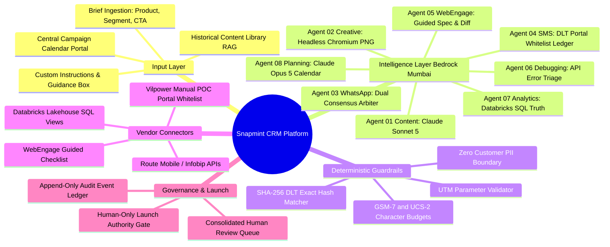
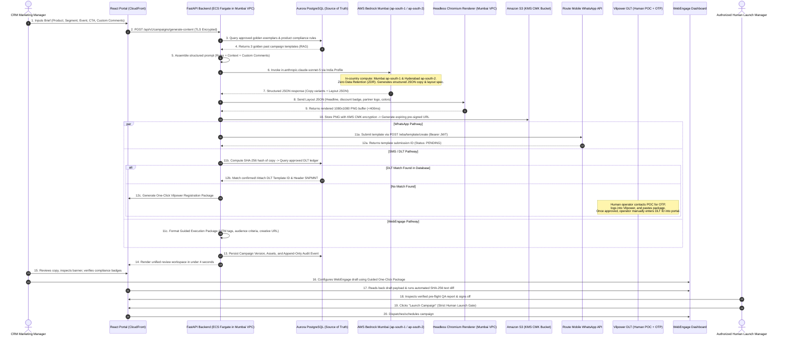
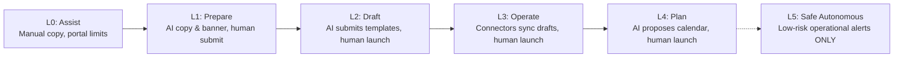

# Snapmint AI CRM Campaign Execution Platform
# Document 1: Overall Agent Architecture & End-to-End Master Plan

**Document Reference:** `SNAP-CRM-DOC1-OVERALL-v2.0`  
**Classification:** Confidential — Snapmint Leadership, CRM Operations & Engineering  
**Target Audience:** Founder, CEO, VP of Product, Head of CRM & Retention, VP of Engineering, Data Leads  
**Author:** Senior Solutions Architecture & Technical Writing Group  

---

## Table of Contents
1. [Executive Vision & System Mindmap](#1-executive-vision--system-mindmap)
2. [End-to-End Request Flow: Where Requests Go From Start to Finish](#2-end-to-end-request-flow-where-requests-go-from-start-to-finish)
3. [The 8 Non-Negotiable Hard Governance Rules](#3-the-8-non-negotiable-hard-governance-rules)
4. [Master Feasibility Scorecard: What is Possible vs. Not Possible](#4-master-feasibility-scorecard-what-is-possible-vs-not-possible)
5. [The End-to-End Agent Ecosystem (Agents 01 through 08)](#5-the-end-to-end-agent-ecosystem-agents-01-through-08)
   - Agent 01: Content & Copywriting Agent
   - Agent 02: Creative Rendering Engine (Deterministic HTML to PNG)
   - Agent 03: WhatsApp Template & Policy Approval Agent
   - Agent 04: SMS / DLT Whitelist & Compliance Engine
   - Agent 05: WebEngage Draft & Execution Spec Agent
   - Agent 06: Debugging & Anomaly Diagnostic Agent
   - Agent 07: Analytics & Databricks Narrative Agent
   - Agent 08: Calendar Planning & Capacity Optimization Agent
6. [Milestone-Driven Roadmap (Waves 0 through 5)](#6-milestone-driven-roadmap-waves-0-through-5)
7. [Autonomy Ladder: Progression to Autonomous CRM Operations](#7-autonomy-ladder-progression-to-autonomous-crm-operations)
8. [Cross-Functional Team Structure](#8-cross-functional-team-structure)

---

## 1. Executive Vision & System Mindmap

Snapmint is India's leading consumer installment (BNPL) platform, enabling millions of customers to purchase electronics, smartphones, and lifestyle goods at 0% or low-cost EMI across partner merchants and direct online checkout.

Today, executing a single CRM campaign requires **24 to 48 hours** because marketing managers must manually coordinate across 4 fragmented systems:
1. **Telecom DLT Portals (Vilpower/Smartping):** Registering SMS templates, obtaining OTPs from authorized company POCs, and manually verifying 160-character limits.
2. **WhatsApp BSP Dashboards (Route Mobile / Infobip / Gupshup):** Formatting templates, managing variable placeholders, and waiting for Meta category approvals.
3. **WebEngage CRM:** Re-typing copy, attaching rendered banners, appending UTM tags, and configuring audience segments.
4. **Internal Admin & Databricks:** Verifying merchant EMI rules and tracking post-campaign attribution.

### The Unified Solution
We are establishing **ONE Central CRM Campaign Calendar Portal**. A marketing manager creates a calendar brief (product line, audience segment, trigger event, channel, CTA, and custom comments). The platform orchestrates specialized AI agents and deterministic engines to prepare verified copy, render brand graphics, validate WhatsApp/DLT compliance, format the WebEngage execution package, and present a pre-flight QA report.

**The Golden Guarantee:** AI agents **NEVER** launch campaigns autonomously. The final launch authority remains 100% human.



---

## 2. End-to-End Request Flow: Where Requests Go From Start to Finish

The following diagram details the exact hop-by-hop journey of every campaign request:



---

## 3. The 8 Non-Negotiable Hard Governance Rules

1. **Strict Permission Separation (No Autonomous Launch):** AI agents never receive campaign-launch authority. The platform enforces four distinct permission tiers: `generate_content`, `submit_template`, `create_update_draft`, and `launch_campaign`. The final launch gate is strictly restricted to authorized human campaign managers.
2. **Authoritative WhatsApp Classification (No Utility Disguise):** Promotional copy must never be disguised as a Utility template to save message fees. Meta and BSP classification algorithms are authoritative. Violations incur quality score demotions and risk WABA suspension.
3. **No Automated Bypass of Telecom Auth (DLT):** Because TRAI mandates human login with SMS OTP sent to the authorized company POC, agents **cannot and will not** automate Vilpower login or CAPTCHA. The platform uses a local pre-approved DLT ledger and generates manual packages for new templates.
4. **Honest Vendor Integration Boundaries:** Where an external vendor API is unsupported (e.g. creating fresh campaign drafts programmatically in WebEngage), the platform generates a production-ready **Execution Specification Package** accompanied by a clearly marked **MANUAL** step in the UI. Systems must never simulate or pretend an external action occurred.
5. **Idempotency & "Needs Verification" State:** Blind retries on external mutation calls are prohibited. Every external write carries an idempotency token: `Hash(campaign_id + version + operation_type)`. If an external call times out or returns an ambiguous network state, the campaign transitions to **"Needs Verification"** and halts downstream dispatches.
6. **Deterministic Code vs. AI Reasoning Separation:**
   - **Deterministic Code Validates:** Character limits, GSM-7/UCS-2 encoding, UTM parameters, destination URLs, variable syntax, exact text hash matching, and read-back diffs.
   - **Deterministic SQL Generates Metrics:** All conversion, GMV, and delivery numbers are derived directly from Databricks Lakehouse SQL views. Large Language Models are strictly prohibited from calculating mathematical figures.
   - **AI Specializes In:** Copywriting, contextual adaptation, brief translation, error explanation, and schedule optimization.
7. **Zero Customer PII in Model Prompts:** Agents receive brief metadata, product parameters, brand guidelines, pre-approved templates, and aggregated demographic cohort statistics. Customer-level Personally Identifiable Information (Names, Phone Numbers, PAN, Bank Details, Credit Limits) is **strictly forbidden** from entering model prompts.
8. **The Portal/Database is the Source of Truth:** The internal Aurora PostgreSQL database is the authoritative system of record. Every agent run, human review, external vendor dispatch, and status transition is recorded in an immutable, append-only audit trail.

---

## 4. Master Feasibility Scorecard: What is Possible vs. Not Possible

Based on live online documentation, regulatory mandates, and AWS service specifications as of October 2026:

| Subsystem | Target Capability | Feasibility Status | Detailed Technical Finding & Implementation Strategy |
|---|---|:---:|---|
| **AWS Bedrock Mumbai (`ap-south-1`)** | Claude Sonnet 5, Opus 5, Haiku 4.5, GPT-5.6 Terra | **HIGH FEASIBILITY** | Supported via **India Geographic Inference Profiles** (`in.anthropic.claude-sonnet-5`, etc.). Dynamically routes compute between Mumbai (`ap-south-1`) and Hyderabad (`ap-south-2`). Data strictly remains inside Indian borders with Zero Data Retention (ZDR), complying with RBI and DPDP Act. |
| **Generative AI Image Generation** | Stable Diffusion / Nova Canvas in India | **NOT POSSIBLE IN INDIA** | No production image generation models exist inside Indian data centers (Stable Diffusion is in `us-west-2`; Nova Canvas EOL Sept 30, 2026).<br>**Our Solution (High Feasibility):** Headless Chromium running inside our Mumbai VPC renders HTML5/CSS3 templates to 1080x1080 PNG in **<400ms** with 100% brand typographic accuracy and zero cross-border data transfer. |
| **WhatsApp Template Submission (Route Mobile)** | Programmatic template creation via API | **HIGH FEASIBILITY** | Verified API: `POST https://apis.rmlconnect.net/wba/template/create` using Bearer JWT authentication (via `/login`). Submits template name, category, language, and components directly to Meta. |
| **WhatsApp Real-Time Status Tracking** | Real-time category check & portal status updates | **HIGH FEASIBILITY** | Meta sends automated `message_template_status_update` webhook events (`APPROVED`, `REJECTED`, `FLAGGED`, `PAUSED`, `CATEGORY_CHANGED`). Ingested via API Gateway and pushed to the React portal in real time via Server-Sent Events (SSE). |
| **Telecom DLT SMS Template Approval via API** | Automated SMS approval via direct telco API | **NOT POSSIBLE (TRAI MANDATE)** | TRAI TCCCPR regulations mandate human web portal login protected by **SMS OTP sent to the authorized company POC + CAPTCHA**. No open public REST API exists for direct automated template creation.<br>**Our Solution (100% Feasible):** Operator manually enters approved DLT IDs and approved text into our portal. Portal maintains a local **SHA-256 Pre-Approved Whitelist Ledger**. Messages matching approved templates pass instantly. |
| **WebEngage Campaign Draft Creation** | Programmatic draft creation from scratch | **NOT POSSIBLE (PUBLIC API)** | WebEngage public REST API only supports triggering transactional campaigns and updating user profiles—no draft creation endpoint.<br>**Our Solution (100% Feasible):** Guided Execution Specification Package with one-click copy buttons + automated read-back diff verification. |
| **Databricks Analytics Join** | Read-only SQL metrics integration | **HIGH FEASIBILITY** | Direct connection to Databricks SQL Warehouse via PrivateLink. Pulls 100% deterministic conversion and delivery numbers. Models never calculate math. |

---

## 5. The End-to-End Agent Ecosystem (Agents 01 through 08)

### Agent 01: Content & Copywriting Agent
* **Foundation Model:** Claude Sonnet 5 (`in.anthropic.claude-sonnet-5`) running via India Geographic Inference Profile in Bedrock.
* **Role:** Transforms brief parameters (product line, audience segment, trigger event, CTA URL, and custom marketer comments) into 3 high-converting copy variants: English, pure Hindi (Devanagari), and conversational Hinglish.
* **Deterministic Guardrails:** Enforces character caps, strips unapproved emojis, and appends validated UTM tracking tags.

### Agent 02: Creative Rendering Engine (Deterministic Layout to PNG)
* **Technology:** Headless Chromium + Playwright container running inside our Mumbai VPC on AWS ECS Fargate.
* **Implementation:** Content Agent generates structured Layout JSON (headline, badge discount, partner logo ID, colors). Headless Chromium injects these tokens into responsive HTML5/CSS3 templates, rendering pixel-perfect 1080x1080 square and 800x418 landscape PNG banners in **under 400 milliseconds**. Claude Sonnet 5 Vision performs automated visual QA (contrast ratio > 4.5:1, zero text clipping).

### Agent 03: WhatsApp Template & Policy Approval Agent
* **Foundation Models:** Dual-Model Consensus (Primary: Claude Sonnet 5; Secondary Arbiter: OpenAI GPT-5.6 Terra).
* **Role:** Validates template structure, prevents promotional messages from being disguised as Utility templates, submits templates programmatically to Route Mobile / Infobip APIs, and tracks real-time approval webhooks.
* **Real-Time Status Synchronization:** Listens to Meta/BSP webhook notifications (`APPROVED`, `REJECTED`, `FLAGGED`, `PAUSED`) and updates the portal UI in real time via Server-Sent Events (SSE).

### Agent 04: SMS / DLT Whitelist & Compliance Engine (TRAI Mandate)
* **Foundation Model:** Claude Haiku 4.5 (`in.anthropic.claude-haiku-4-5`) + Deterministic SHA-256 Hashing.
* **The Operational Truth:** Because Vilpower requires human POC OTP login, the agent **never attempts to automate DLT login**.
* **Implementation:** 
  1. The portal maintains a **Local SHA-256 Pre-Approved DLT Whitelist Ledger** (manually populated by CRM operations with approved DLT Template IDs, Header IDs like `SNPMNT`, and exact approved copy).
  2. When the Content Agent generates SMS copy, the system normalizes the text and computes its SHA-256 hash. If it matches an approved entry in the database, it is instantly marked **"DLT Whitelisted (Green)"**.
  3. If new copy is generated that is not in the database, the portal outputs a **One-Click Vilpower Registration Package**. The operator contacts the POC for the OTP, logs into Vilpower, registers the template, and pastes the approved DLT ID and text into the portal.
  4. Calculates exact character counts for **GSM-7** (160 chars/credit) vs. **UCS-2** (70 chars/credit for Hindi/Devanagari).

### Agent 05: WebEngage Draft & Execution Spec Agent
* **Foundation Model:** Claude Sonnet 5.
* **Role:** Assembles verified copy, creative S3 URLs, UTM strings, and audience criteria into a structured **Guided Execution Specification Package**.
* **Read-Back Verification Diff:** Reads back the draft configuration from WebEngage and executes an automated field-by-field SHA-256 diff. If any copy text, link, or variable differs, the campaign is flagged with a "Draft Mismatch" warning and blocked from launching.

### Agent 06: Debugging & Anomaly Diagnostic Agent
* **Foundation Model:** Claude Sonnet 5.
* **Role:** Ingests error responses from external APIs (WhatsApp BSPs, SMS gateways, WebEngage), triages root causes (quota exhaustion, invalid phone number, variable syntax mismatch, template category demotion), and proposes concrete remediation steps.

### Agent 07: Analytics & Databricks Narrative Agent
* **Foundation Model:** Claude Sonnet 5 + Databricks SQL Warehouse.
* **The Golden Rule:** Models never calculate math. All delivery rates, click-through rates (CTR), BNPL checkout conversion rates, and 30-day EMI default rates come directly from verified Databricks SQL queries.
* **Feedback Loop:** Ingests SQL metrics, writes executive WoW/MoM narratives, and automatically tags top-performing campaigns (top 10% conversion) to be seeded into the Bedrock Knowledge Base content library.

### Agent 08: Calendar Planning & Capacity Optimization Agent
* **Foundation Model:** Claude Opus 5 (`in.anthropic.claude-opus-5`) combined with a deterministic constraint solver.
* **Role:** Balances customer frequency caps (e.g. max 2 WhatsApps and 3 SMS per user per week) and channel budgets to propose optimal weekly and monthly CRM schedules.

---

## 6. Milestone-Driven Roadmap (Waves 0 through 5)

*(Presented as milestone-driven delivery waves without arbitrary calendar end-dates)*

```
+---------------------------------------------------------------------------------------------------------+
| MILESTONE-DRIVEN DELIVERY ROADMAP                                                                       |
+---------+-----------------------------+-----------------------------------------------------------------+
| Wave    | Focus Area                  | Key Milestone Deliverables                                      |
+---------+-----------------------------+-----------------------------------------------------------------+
| Wave 0  | Foundations & Spikes        | Golden eval dataset (50 past campaigns), Bedrock Mumbai setup,  |
|         |                             | Route Mobile API validation, and DLT local ledger seeding.      |
| Wave 1  | The Portal & Content Engine | Working Campaign Calendar Portal, brief ingestion with custom   |
|         | (Current Phase 1 Focus)     | comments, Bedrock Content Agent, and headless PNG rendering.    |
| Wave 2  | WhatsApp & SMS Automation   | Route Mobile API automated template submission, dual-model      |
|         |                             | policy check, and WebEngage read-back diff verification.        |
| Wave 3  | Regional Breadth & Debugging| Full colloquial Hinglish and Hindi copy models, Push specs, and |
|         |                             | automated API Error Diagnostic Agent.                           |
| Wave 4  | Databricks Lakehouse Loop   | Lakehouse SQL connection, deterministic conversion reporting,   |
|         |                             | and auto-seeding top 10% campaigns into library.                |
| Wave 5  | Calendar Planning Agent     | Capacity-aware monthly schedule generator enforcing customer    |
|         |                             | frequency caps and channel budget ceilings.                     |
+---------+-----------------------------+-----------------------------------------------------------------+
```

---

## 7. Autonomy Ladder: Progression to Autonomous CRM Operations



* **L0: Assist (Baseline):** Marketing managers manually draft briefs; deterministic engines validate character limits and UTM parameters.
* **L1: Prepare (Wave 1):** Content Agent generates copy variants and creative layout specs; human reviews and copies assets to vendor tools.
* **L2: Draft (Wave 2):** WhatsApp Agent submits templates via BSP API; platform prepares WebEngage execution packages and verifies drafts via read-back diffs.
* **L3: Operate (Wave 3):** Automated template tracking, automated error diagnosis, and lakehouse performance feedback active across all channels.
* **L4: Plan (Wave 5):** Planning Agent proposes the weekly campaign calendar, balancing capacity, audience fatigue, and historical conversion curves.
* **L5: Optional Safe Autonomous (Future Policy Decision):** Automated execution restricted strictly to pre-approved, non-promotional, low-risk operational updates (e.g., standard billing date alerts). **In initial releases, L5 is disabled across the codebase.**

---

## 8. Cross-Functional Team Structure

To deliver this platform across the waves, a dedicated pod of **5 Full-Time Engineers (FTEs)** is allocated:

1. **1 Lead Solutions Architect / Tech Lead:** Overall architecture, AWS infrastructure, security governance, and vendor technical alignment.
2. **1 Senior Frontend Engineer:** React 19 + TypeScript portal, calendar interface, brief form, and review queue UI.
3. **1 Senior Backend / Workflow Engineer:** Python (FastAPI) core services, PostgreSQL database schema, AWS Step Functions, and idempotency logic.
4. **1 AI / Prompt & Evaluation Engineer:** Bedrock prompt engineering, Bedrock Knowledge Base setup, golden evaluation harness, model bake-off, and guardrail rules.
5. **1 Integration & Data Engineer:** Third-party connectors (Route Mobile, Infobip, DLT, WebEngage), Chromium rendering container, and Databricks SQL pipelines.

---
*This document defines the high-level roadmap and architectural standard for the Snapmint CRM Campaign Execution Platform.*
