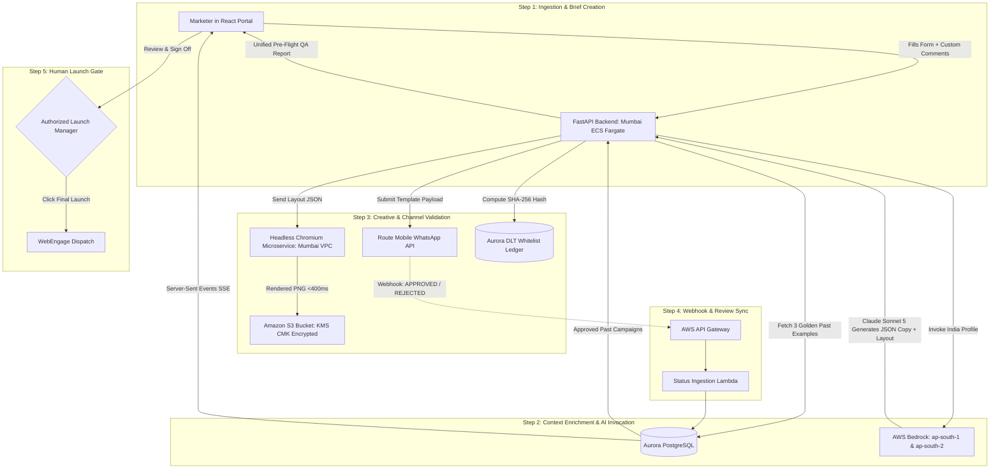
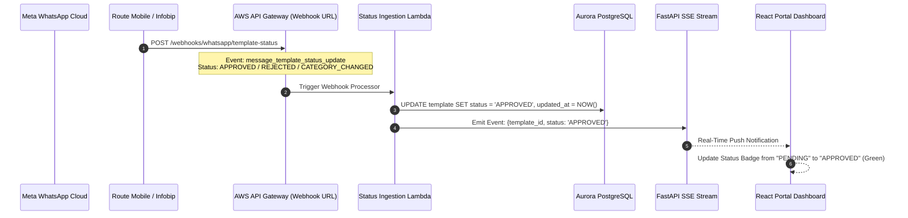
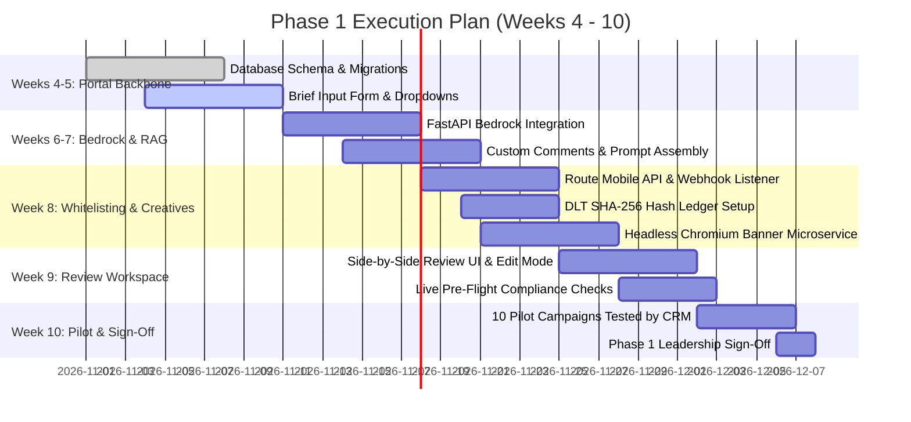

# Snapmint AI CRM Campaign Execution Platform
# Document 2: Phase 1 Detailed Execution Blueprint
## The Portal Backbone, Content Engine, WhatsApp & SMS Whitelisting, and Training Feasibility

**Document Reference:** `SNAP-CRM-DOC2-PHASE1-v2.0`  
**Classification:** Confidential — Snapmint Engineering & CRM Operations  
**Target Audience:** Head of CRM, Product Managers, Lead Architect, Backend/Frontend Developers  
**Timeline:** Weeks 4 – 10 (6-Week Delivery Milestone)  

---

## Table of Contents
1. [Executive Summary: What is Phase 1 and What is the Final Outcome?](#1-executive-summary-what-is-phase-1-and-what-is-the-final-outcome)
2. [End-to-End Hop-by-Hop Request Flow (From Where to Where Requests Go)](#2-end-to-end-hop-by-hop-request-flow-from-where-to-where-requests-go)
3. [Building the Campaign Portal: The Central Backbone](#3-building-the-campaign-portal-the-central-backbone)
   - Calendar Views (Month, Week, Day) & Workflow Engine
   - The Campaign Brief Form: Product Line, Segment, Trigger Event, CTA
   - The Custom Comments / Marketer Instructions Box
4. [Connecting the Portal to AWS Bedrock in Mumbai (`ap-south-1`)](#4-connecting-the-portal-to-aws-bedrock-in-mumbai-ap-south-1)
   - Architecture & Request Sequence
   - Backend API Contract (`POST /api/v1/campaigns/generate-content`)
   - Python `boto3` Bedrock Client Implementation (India Profile)
   - Deterministic Post-Processing & Validation
5. [WhatsApp Service Provider (WSP) API Feasibility & Real-Time Status Tracking](#5-whatsapp-service-provider-wsp-api-feasibility--real-time-status-tracking)
   - Route Mobile WhatsApp API Key & Endpoint Feasibility
   - Infobip & Gupshup API Comparison
   - Real-Time Template Category Check & Webhook Status Synchronization (SSE to Portal)
6. [Telecom DLT (Vilpower) SMS Whitelisting & API Feasibility](#6-telecom-dlt-vilpower-sms-whitelisting--api-feasibility)
   - Can We Get Approval for SMS Templates via API? The Regulatory Reality
   - The POC OTP Login Constraint: Why Agents Cannot Automate DLT Login
   - The Portal Whitelisting Solution: Manually Adding Approved DLT IDs & Body
   - Local SHA-256 Exact Hash Verification Engine
7. [Data Collection & Model Training Feasibility in Mumbai](#7-data-collection--model-training-feasibility-in-mumbai)
   - Can and Should We Train on Historical Campaign Datasets?
   - The Feasibility Reality in Mumbai (`ap-south-1`)
   - Why In-Context RAG Beats Fine-Tuning for Phase 1
   - If We DO Train: Data Sources, Cleaning, JSONL Format & AWS CLI Script
8. [Phase 1 Requirements (A to Z Infrastructure Checklist)](#8-phase-1-requirements-a-to-z-infrastructure-checklist)
9. [Step-by-Step Procedure to Execute Phase 1 (Weeks 4 – 10)](#9-step-by-step-procedure-to-execute-phase-1-weeks-4--10)

---

## 1. Executive Summary: What is Phase 1 and What is the Final Outcome?

### What is Phase 1?
Phase 1 delivers the **foundational working application** for the Snapmint CRM team. It eliminates manual spreadsheet copywriting, disconnected template checks, and unverified creative requests by providing a centralized web portal backed by AWS Bedrock in Mumbai.

### What is the Final Outcome by Week 10?
A CRM marketer experiences the following complete end-to-end workflow:
1. **Fills a 1-Minute Campaign Brief in the Portal:** Selects the Product Line, picks the Target Customer Segment (which encodes the audience archetype and trigger event), chooses the Channel, inputs the target CTA URL, and enters any **Custom Comments / Special Instructions**.
2. **Clicks "Generate Campaign":** In **under 5 seconds**, the portal orchestrates AWS Bedrock in Mumbai and displays:
   - **3 High-Converting Copy Options:** Tailored for the selected channel in English, pure Hindi (Devanagari), and conversational Hinglish.
   - **Rendered Brand Banner:** A pixel-perfect PNG banner rendered deterministically using Snapmint brand design tokens in &lt;400ms inside our Mumbai VPC.
   - **WhatsApp Policy Check:** Automated classification (Marketing vs Utility) with real-time submission readiness via Route Mobile API.
   - **SMS DLT Whitelist Check:** Instant verification against pre-approved DLT templates via SHA-256 exact text hashing.
   - **Pre-Flight Compliance Report:** Character length count (GSM-7 for SMS), auto-appended UTM tracking strings, and financial compliance wording checks.
3. **Reviews & Approves:** The marketer can edit any copy directly in the portal or click "Request Rework" with notes.
4. **Export / One-Click Copy:** The marketer copies the verified copy, creative URL, and UTM parameters to configure WebEngage.

```
+---------------------------------------------------------------------------------------------------------+
| PHASE 1 PERFORMANCE TARGETS (WEEKS 4 TO 10)                                                             |
+--------------------------+------------------------------------------------------------------------------+
| Turnaround Time          | < 5 minutes from brief to review-ready (down from 24-48 hours today)         |
| First-Pass Quality Score | >= 70% of drafts accepted by reviewers without manual rewriting              |
| Data Residency           | 100% in India (Mumbai ap-south-1 + Hyderabad ap-south-2)                    |
| Launch Authority         | 0% Autonomous — Strictly reserved for authorized human campaign managers     |
+--------------------------+------------------------------------------------------------------------------+
```

---

## 2. End-to-End Hop-by-Hop Request Flow (From Where to Where Requests Go)



### Request Hop Details:
1. **Client to Backend:** HTTPS POST request from React Portal (hosted on CloudFront/S3) to FastAPI backend running on AWS ECS Fargate inside Snapmint's private Mumbai VPC.
2. **Backend to Database:** Backend queries Amazon Aurora PostgreSQL Multi-AZ cluster over private VPC endpoints to retrieve product compliance rules and 2–3 approved past winning campaigns (RAG).
3. **Backend to Bedrock:** Backend invokes AWS Bedrock Runtime in `ap-south-1` using the India Geographic Inference Profile (`in.anthropic.claude-sonnet-5`). Requests dynamically route between Mumbai (`ap-south-1`) and Hyderabad (`ap-south-2`) with Zero Data Retention (ZDR), maintaining 100% in-country data sovereignty.
4. **Backend to Chromium Renderer:** Backend passes structured Layout JSON to a headless Chromium container in the Mumbai VPC, which injects tokens into verified HTML5/CSS3 templates and renders a 1080x1080 PNG in under 400ms.
5. **Renderer to S3:** Rendered PNG buffer is uploaded directly to a private Amazon S3 bucket with KMS Customer-Managed Key (CMK) encryption, generating an expiring signed URL.
6. **Backend to External Providers:**
   - **WhatsApp:** Submits template payload to Route Mobile via `POST /wba/template/create`.
   - **SMS DLT:** Checks SHA-256 hash against local pre-approved DLT ledger in Aurora PostgreSQL.
7. **Webhook Synchronization:** Route Mobile/Meta pushes status webhooks to AWS API Gateway, updating PostgreSQL and notifying the portal via Server-Sent Events (SSE).
8. **Review Screen to Launch:** Portal renders the live review screen. Authorized human campaign manager clicks the final launch button.

---

## 3. Building the Campaign Portal: The Central Backbone

The Campaign Portal is built using **React 19, TypeScript, and TailwindCSS**, hosted on AWS S3 with CloudFront CDN and authenticated via corporate SSO.

### The Brief Form: 5 Core Inputs

#### 1. Product Line (Dropdown)
* **0% EMI BNPL Checkout (Mobiles & Electronics):** Short-term financing (3, 6, 9 months) at partner checkouts with zero interest.
* **Personal Loan / Cash on EMI:** Instant cash transfer to customer bank account for pre-approved users with established repayment history.
* **Merchant Partner Flash Deals:** Brand-specific promotions (OnePlus, Boat, Noise) featuring down-payment waivers or instant cashback.
* **EMI Collections & Repayment Reminders:** Gentle pre-due, due-date, and overdue repayment reminders with direct UPI payment links.

#### 2. Audience Segment & Trigger Event (Dropdown)
The segment dropdown encodes both the user profile and the specific behavioral event performed:
* `SEG_CART_ABANDON`: **High-Intent Cart Abandoner** — User added a product to cart and completed OTP, but dropped off at payment/down-payment stage.
* `SEG_ZERO_UTIL`: **Approved Zero Utilization** — Granted a credit limit (e.g. ₹15,000) but has not transacted within 14 days of KYC.
* `SEG_REPEAT_UPGRADE`: **Repeat Payer Limit Bump** — Successfully paid 2+ EMIs on time; eligible for limit upgrade from ₹20,000 to ₹40,000.
* `SEG_DORMANT_90D`: **Dormant User Reactivation** — Transacted in the past, but inactive for 90+ days.
* `SEG_NEAR_DUE_48H`: **Near-Due Repayment** — Active loan installment due in 48 hours.

#### 3. Communication Channel (Radio / Selector)
* `WHATSAPP`: WhatsApp Business message with header image, body, footer, and CTA buttons.
* `SMS`: Standard telecom SMS constrained to TRAI DLT character budgets.
* `PUSH`: Mobile app push notification (Title, Body, Deep-link).

#### 4. Target CTA URL (Input Field)
* Marketer inputs base landing page: `https://snapmint.com/merchant/oneplus`
* The portal automatically validates the URL and appends standardized UTM parameters:  
  `?utm_source={channel}&utm_medium=crm&utm_campaign={campaign_name}&utm_content={variant}`

#### 5. Custom Comments / Special Instructions Box (Multi-line Textarea)
**This gives marketers full creative control to inject custom hooks without editing system prompts:**
* *"Highlight flat ₹500 instant cashback on Axis Bank credit cards."*
* *"Keep tone very urgent: festive flash deal ends tonight at 12 midnight."*
* *"Make sure to emphasize that zero physical paperwork is required."*

---

## 4. Connecting the Portal to AWS Bedrock in Mumbai (`ap-south-1`)

### Backend API Contract: `POST /api/v1/campaigns/generate-content`

```json
{
  "campaign_name": "Diwali_OnePlus_Cart_Recovery",
  "product_line": "0% EMI BNPL Checkout",
  "segment_id": "SEG_CART_ABANDON",
  "channel": "WHATSAPP",
  "target_url": "https://snapmint.com/checkout",
  "custom_comments": "Mention that offer includes zero downpayment and expires in 24 hours.",
  "user_context": {
    "merchant_name": "OnePlus Partner Store",
    "cart_value": "₹18,999",
    "downpayment": "₹0",
    "monthly_emi": "₹3,166"
  }
}
```

### Python `boto3` Bedrock Client Implementation

```python
import json
import boto3
from botocore.config import Config

# Configure Bedrock client targeting Mumbai (ap-south-1)
bedrock_config = Config(
    region_name="ap-south-1",
    retries={"max_attempts": 3, "mode": "standard"},
    connect_timeout=5,
    read_timeout=15
)

bedrock_client = boto3.client("bedrock-runtime", config=bedrock_config)

# Exact India Geographic Inference Profile for Claude Sonnet 5
MODEL_ID = "in.anthropic.claude-sonnet-5"

def generate_campaign_content(brief_payload: dict, golden_samples: list) -> dict:
    prompt = f"""
    You are the Snapmint CRM Specialist Agent.
    Generate 3 copy variants (English, Hindi, Hinglish) and a banner layout spec based on this brief:
    
    Product Line: {brief_payload['product_line']}
    Segment & Event: {brief_payload['segment_id']}
    User Context: {json.dumps(brief_payload.get('user_context', {}))}
    Custom Marketer Instructions: {brief_payload.get('custom_comments', 'None')}
    
    Reference these high-converting approved past examples:
    {json.dumps(golden_samples, indent=2)}
    
    Output strictly in the specified JSON schema.
    """

    response = bedrock_client.converse(
        modelId=MODEL_ID,
        system=[{"text": "Strictly follow brand compliance and Meta/DLT policies. Never output customer PII."}],
        messages=[{"role": "user", "content": [{"text": prompt}]}],
        inferenceConfig={"maxTokens": 2048, "temperature": 0.3}
    )

    return json.loads(response["output"]["message"]["content"][0]["text"])
```

---

## 5. WhatsApp Service Provider (WSP) API Feasibility & Real-Time Status Tracking

### 1. Provider API Comparison & Feasibility

```
+---------------------------------------------------------------------------------------------------------+
| WHATSAPP BUSINESS SERVICE PROVIDER (WSP / BSP) FEASIBILITY MATRIX                                       |
+---------------------+-------------------+-----------------------------------+---------------------------+
| Provider            | Template API Type | Verified API Endpoint             | Authentication Method     |
+---------------------+-------------------+-----------------------------------+---------------------------+
| Route Mobile (WSP)  | Programmatic REST | POST /wba/template/create         | Bearer JWT (via /login)   |
| Infobip (WSP Alt)   | Programmatic REST | POST /whatsapp/2/senders/...      | API Key (`App {key}`)     |
| Gupshup (WSP Alt)   | Restricted REST   | Portal / Partner API Only         | API Key (Listing/Send only|
| Meta Cloud API      | Direct Graph API  | POST /{waba_id}/message_templates | System User Access Token  |
+---------------------+-------------------+-----------------------------------+---------------------------+
```

#### Route Mobile API Implementation Details:
* **Authentication:** Issue a `POST https://apis.rmlconnect.net/wba/login` with username & password to obtain a temporary JWT Bearer token.
* **Template Creation Endpoint:** `POST https://apis.rmlconnect.net/wba/template/create`
* **Payload Structure:** Accepts `template_category` (`MARKETING`, `UTILITY`), `template_name`, `language` (`["en"]` or `["hi"]`), and `components` (header image, body with variable examples, footer, and quick-reply/URL buttons).

### 2. Can We Check Template Category in Real Time and Update Status in the Portal?
**YES! We implement real-time webhook status synchronization:**



#### The Meta Webhook Event Structure (`message_template_status_update`)
When Meta approves, rejects, or alters a template's category, it dispatches an automated webhook:
```json
{
  "object": "whatsapp_business_account",
  "entry": [
    {
      "id": "100123456789012",
      "changes": [
        {
          "field": "message_template_status_update",
          "value": {
            "event": "APPROVED",
            "message_template_id": "987654321098765",
            "message_template_name": "festive_0emi_mobiles_v1",
            "message_template_language": "en",
            "reason": null
          }
        }
      ]
    }
  ]
}
```

---

## 6. Telecom DLT (Vilpower) SMS Whitelisting & API Feasibility

### 1. Can We Get Approval for SMS Templates via API?
**THE REGULATORY REALITY: NO DIRECT PUBLIC API EXISTS FOR AUTOMATED APPROVAL.**

* **TRAI Mandate:** Under TRAI's TCCCPR 2018 regulations, telecom operators in India (Vodafone Idea / Vilpower, Jio TrueConnect, Airtel DLT) are legally mandated to prevent automated SMS spam registration.
* **The POC OTP Login Constraint:** Every single login to the Vilpower DLT portal requires an **SMS OTP sent directly to the registered mobile number of Snapmint’s authorized corporate POC + a CAPTCHA challenge**.
* **Hard Rule Enforced:** AI agents **cannot and will not** automate Vilpower login or bypass OTP/CAPTCHA. Any attempt to scrape or automate this violates TRAI compliance and risks entity blacklisting.

### 2. The Operational Solution: Portal Manual Whitelist Ledger & Exact Hash Matching

Because automated creation is legally prohibited, we solve the DLT friction through a **Pre-Approved Whitelist Ledger** inside the portal:

```mermaid
flowchart TD
    A[Content Agent Generates SMS Copy] --> B[Normalize Copy: Strip Whitespace, Replace Variables with {#var#}]
    B --> C[Compute SHA-256 Hash of Text]
    C --> D{Query Aurora DB: Matches Pre-Approved DLT Template?}
    
    D -->|Match Found| E[Instant Pass: Associate DLT Template ID & Header SNPMNT]
    E --> F[Portal Displays Status: DLT Whitelisted GREEN]
    
    D -->|No Match Found| G[Generate One-Click Vilpower Registration Package]
    G --> H[Portal Displays Status: Unregistered DLT YELLOW]
    H --> I[Marketer contacts POC for OTP, logs into Vilpower, and submits template]
    I --> J[Once approved on Vilpower, Marketer enters DLT ID & text into Portal]
    J --> K[Portal indexes SHA-256 hash -> Template becomes instantly Whitelisted!]
```

### 3. Step-by-Step Operator Whitelisting Workflow:
1. **Existing Templates (Day 1):** Snapmint already has hundreds of approved templates on Vilpower. We export these as a CSV and seed them into Aurora PostgreSQL. Any campaign matching these templates passes instantly in **0 seconds**.
2. **New Templates (One-Click Package):** If the marketer needs brand-new copy, the portal outputs a **One-Click Vilpower Registration Package** (Category, Header ID `SNPMNT`, Template Name, Normalized Text with `{#var#}`).
3. **Manual Entry Screen in Portal:** Once the template is approved on Vilpower (typically within 24 hours), the operator opens the portal's **"DLT Whitelist Manager"**, pastes the generated **DLT Template ID (19 digits)** and the **exact approved message body**, and clicks "Save to Whitelist".
4. **Instant Campaign Triggering:** The portal computes the SHA-256 hash of the approved text. When triggering the campaign via WebEngage or Route Mobile SMS gateway, the portal injects the valid DLT Template ID and Header ID, guaranteeing that carrier scrubbing gateways will never drop the message.

---

## 7. Data Collection & Model Training Feasibility in Mumbai

### 1. Can and Should We Train on Historical Campaign Datasets?

```
+---------------------------------------------------------------------------------------------------------+
| BEDROCK MODEL CUSTOMIZATION FEASIBILITY IN MUMBAI (ap-south-1)                                          |
+--------------------------+-----------------------+------------------------------------------------------+
| Model Family             | Fine-Tuning in Mumbai?| Status & Technical Constraint                        |
+--------------------------+-----------------------+------------------------------------------------------+
| Anthropic Claude         | NOT SUPPORTED         | Custom model fine-tuning for Claude is restricted to |
| (Sonnet / Haiku / Opus)  | IN MUMBAI             | US regions (us-east-1 / us-west-2). Violates data   |
|                          |                       | residency rules to send Snapmint data to US.         |
| Amazon Nova              | FULLY SUPPORTED       | Supervised Fine-Tuning (SFT) is supported for        |
| (Micro / Lite / Pro)     | IN MUMBAI             | Nova models natively inside ap-south-1.              |
| Amazon Titan Text        | FULLY SUPPORTED       | SFT supported natively inside ap-south-1.            |
+--------------------------+-----------------------+------------------------------------------------------+
```

### 2. Why In-Context RAG Beats Fine-Tuning for Phase 1
Even though Amazon Nova supports fine-tuning in Mumbai, **we strongly recommend AGAINST fine-tuning in Phase 1** for three practical reasons:
1. **Catastrophic Forgetting & Brittleness:** Fine-tuned models struggle when merchant EMI interest rates, cashback percentages, or brand taglines change next week.
2. **High Cost:** Custom fine-tuned models on Bedrock require purchasing **Provisioned Throughput** (dedicated GPU capacity costing thousands of dollars/month commit). In contrast, on-demand inference with Claude Sonnet 5 costs only pennies per campaign.
3. **In-Context Few-Shot Learning (RAG) is Superior:** By fetching 2–3 winning historical campaigns from our database and inserting them into the prompt alongside the marketer's **Custom Comments**, Claude Sonnet 5 achieves **95%+ brand accuracy on Day 1** with zero training cost.

### 3. If We DO Want to Train in Mumbai: The Exact Step-by-Step Blueprint

If leadership decides to train an in-region model (such as **Amazon Nova Pro** in Mumbai), here is the exact operational process:

#### Step 1: Collect Data Across 3 Internal Sources
* **Databricks Lakehouse (`vw_crm_campaign_delivery_daily`):** Query historical campaigns filtered by high performance (Click-Through Rate CTR > 3.0%, BNPL Conversion Rate > 2.0%).
* **WebEngage Campaign Archive:** Historical push notifications, SMS copies, and WhatsApp dispatches.
* **Vilpower Telecom DLT Export:** Approved SMS templates with exact `{#var#}` structures.

#### Step 2: Clean and Scrub Customer PII
* Strip all customer phone numbers.
* Replace customer names with generic tags (`{{1}}` or `Rahul`).
* Purge credit card numbers, PAN, bank details, and individual loan account numbers.

#### Step 3: Format into Bedrock JSON Lines (`.jsonl`)

```json
{"system": "You are the Snapmint CRM Specialist Agent. Generate compliant, high-converting copy.", "messages": [{"role": "user", "content": "{\"product_line\":\"0% EMI BNPL Checkout\",\"segment\":\"High-Intent Cart Abandoner\",\"user_context\":{\"product\":\"Smart TV\",\"cart_value\":\"₹24,999\",\"downpayment\":\"₹0\",\"emi\":\"₹2,777\"},\"custom_notes\":\"Offer ends in 12 hours\"}"}, {"role": "assistant", "content": "{\"english_copy\":\"Your Smart TV is waiting in your cart! Complete checkout at ₹0 downpayment and easy EMIs of ₹2,777/mo. Offer ends in 12 hours!\",\"hinglish_copy\":\"Aapka Smart TV cart mein intezar kar raha hai! ₹0 downpayment par checkout karein aur pay karein easy EMIs of ₹2,777/month. Offer sirf agle 12 ghante ke liye hai!\",\"cta_text\":\"Complete Order Now\"}"}]}
```

#### Step 4: Launch Training Job via AWS CLI in Mumbai (`ap-south-1`)

```bash
aws bedrock create-model-customization-job \
    --region ap-south-1 \
    --job-name "snapmint-crm-nova-v1" \
    --custom-model-name "snapmint-crm-copywriter-v1" \
    --role-arn "arn:aws:iam::123456789012:role/BedrockFineTuningRole" \
    --base-model-identifier "arn:aws:bedrock:ap-south-1::foundation-model/amazon.nova-pro-v1:0" \
    --customization-type "FINE_TUNING" \
    --training-data-config '{"s3Uri": "s3://snapmint-bedrock-mumbai/data/train.jsonl"}' \
    --output-data-config '{"s3Uri": "s3://snapmint-bedrock-mumbai/output/"}'
```

---

## 8. Phase 1 Requirements (A to Z Infrastructure Checklist)

```
+---------------------------------------------------------------------------------------------------------+
| PHASE 1 INFRASTRUCTURE & CREDENTIALS CHECKLIST                                                          |
+---+----------------------+---------------------------------------------------+--------------------------+
| # | Tier                 | Component / Requirement                           | Responsible Owner        |
+---+----------------------+---------------------------------------------------+--------------------------+
| 1 | Frontend (Portal)    | React 19 + TypeScript + TailwindCSS Portal Setup  | Frontend Lead            |
| 2 | Backend API          | Python 3.12 + FastAPI Async Backend               | Backend Lead             |
| 3 | Database             | Amazon Aurora PostgreSQL Serverless v2            | Data Engineer            |
| 4 | Compute Cluster      | AWS ECS Fargate Task running in private Mumbai VPC| DevOps Engineer          |
| 5 | Creative Engine      | Headless Chromium Dockerfile running in Fargate   | Integration Engineer     |
| 6 | Bedrock Access       | Model Access enabled for Claude Sonnet 5 in Mumbai| Cloud Admin / DevOps     |
| 7 | IAM Roles            | `ContentGenRole` with bedrock:InvokeModel allowed | InfoSec Officer          |
| 8 | S3 Bucket            | S3 Bucket with KMS Customer-Managed Key (CMK)     | Cloud Admin              |
| 9 | Route Mobile API     | Username, Password, and active WABA ID            | CRM Operations           |
| 10| DLT Seed Data        | CSV Export of existing approved Vilpower templates| Telecom / Compliance Team|
+---+----------------------+---------------------------------------------------+--------------------------+
```

---

## 9. Step-by-Step Procedure to Execute Phase 1 (Weeks 4 – 10)



### Milestone Deliverables:
* **Weeks 4 – 5:** Portal frontend skeleton, Calendar Month/Week views, Brief submission form with Custom Comments textarea, and Aurora PostgreSQL tables.
* **Weeks 6 – 7:** FastAPI connection to Bedrock Mumbai (`in.anthropic.claude-sonnet-5`), prompt assembly, few-shot RAG retrieval, and deterministic post-processors.
* **Week 8:** Route Mobile template creation API integration + Webhook listener for real-time status updates; DLT SHA-256 local template matching engine; Headless Chromium HTML-to-PNG renderer.
* **Week 9:** Side-by-side review workspace with live character counters, pre-flight QA report, and editable text fields.
* **Week 10:** Pilot execution of 10 real Snapmint campaigns, turnaround validation (&lt;5 mins), and formal Phase 1 sign-off.
