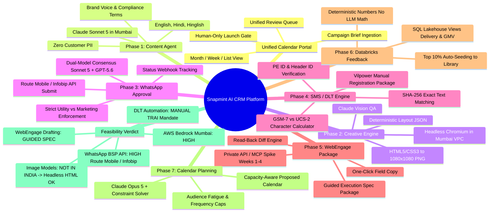
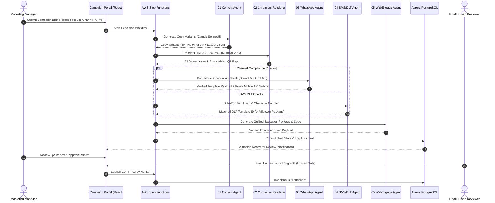

# Snapmint AI CRM Campaign Execution Platform
# Master Feasibility, Integration & Operational Execution Blueprint

**Document Reference:** `SNAP-CRM-ARCH-2026-v1.0`  
**Classification:** Confidential — Snapmint Internal Architecture & Leadership Brief  
**Target Stakeholders:** Founders, CEO, VP of Product, Head of CRM & Retention, VP of Engineering, Head of Information Security, Lead Data Architect  
**Author:** Senior Solutions Architecture & Technical Writing Group  

---

## Table of Contents
1. [Executive Summary & Core Mindmap](#1-executive-summary--core-mindmap)
2. [End-to-End Feasibility Assessment: Will It Work or Not?](#2-end-to-end-feasibility-assessment-will-it-work-or-not)
   - AWS Bedrock in Mumbai (`ap-south-1`) & India-Only Routing
   - Creative & Image Generation Reality
   - WhatsApp BSP APIs (Route Mobile, Gupshup, Infobip, Meta Cloud API)
   - Telecom DLT Portals (Vilpower / Jio / Airtel)
   - WebEngage Integration & Campaign Drafting Reality
3. [The Master Credentials & Vendor Access Checklist (A to Z)](#3-the-master-credentials--vendor-access-checklist-a-to-z)
   - Exactly what credentials, permissions, and network access we need from whom
4. [Model Training & Fine-Tuning Blueprint for Snapmint](#4-model-training--fine-tuning-blueprint-for-snapmint)
   - Why RAG First vs. Model Fine-Tuning
   - Fine-Tuning Data Requirements: Product Lines, Lifecycle Segments, Volume & JSONL Schemas
   - Real-World Snapmint Segment Examples (Cart Abandonment, Repeat Limit, Lapsed, Near-Due)
5. [Phase-by-Phase Engine Architecture & Execution Plan](#5-phase-by-phase-engine-architecture--execution-plan)
   - Phase 1: Content & Localization Agent
   - Phase 2: Creative Engine (Deterministic HTML/CSS to PNG)
   - Phase 3: WhatsApp Approval Agent (Dual-Model Consensus)
   - Phase 4: SMS / DLT Compliance Engine (Exact Hash Matching)
   - Phase 5: WebEngage Draft Execution Package & Read-Back Diff
   - Phase 6: Analytics & Databricks Lakehouse Feedback Loop
   - Phase 7: Calendar Planning & Capacity Optimization Agent
6. [Complete Internal Technology Stack (A to Z)](#6-complete-internal-technology-stack-a-to-z)
7. [Governance, Hard Rules & Operational Safety Boundary](#7-governance-hard-rules--operational-safety-boundary)

---

## 1. Executive Summary & Core Mindmap

Snapmint processes thousands of daily transactions across its partner merchant network and direct mobile application. The CRM team runs hundreds of campaigns monthly across WhatsApp, SMS, Push notifications, and In-App messages to drive conversions, remind users of EMI schedules, announce 0% EMI merchant promotions, and reactivate dormant customers.

Currently, this requires manual copy-pasting across **four disconnected dashboards**:
1. **Telecom DLT Portal (e.g. Vilpower):** Manual submission, OTP/CAPTCHA, Header ID, Template ID mapping.
2. **WhatsApp BSP Portal (Route Mobile / Gupshup / Infobip):** Manual template creation, Category assignment, variable testing.
3. **WebEngage Dashboard:** Manual campaign builder, audience selection, UTM tagging, creative asset linking.
4. **Internal Admin & Databricks:** Checking merchant availability, credit rules, and tracking performance.

**The Target State:** A unified **CRM Campaign Calendar Portal**. A marketing manager creates a calendar entry with business targets, product line, customer segment, and CTA. Seven specialized AI agents and deterministic engines collaborate to generate localized copy, render pixel-perfect brand creatives, verify DLT/WhatsApp compliance, and produce a verified WebEngage execution package. 

**The Golden Guarantee:** AI agents **NEVER** launch campaigns autonomously. A human campaign manager must review the unified QA report and provide the final launch approval.

### Master Visual Mindmap



---

## 2. End-to-End Feasibility Assessment: Will It Work or Not?

Here is the unvarnished technical assessment based on verified online documentation, regulatory mandates, and AWS service specifications as of October 2026.

```
+---------------------------------------------------------------------------------------------------+
| SUMMARY FEASIBILITY SCORECARD: SNAPMINT CRM PLATFORM                                              |
+------------------------------------+-------------------+------------------------------------------+
| Subsystem                          | Feasibility Status| Key Constraint / Solution                |
+------------------------------------+-------------------+------------------------------------------+
| Bedrock Mumbai (ap-south-1)        | HIGH FEASIBILITY  | India Geographic Profile (Mumbai+Hyd)    |
| Visual Creative Generation         | WORKAROUND (HIGH) | Headless Chromium HTML->PNG (No GenAI)   |
| WhatsApp Template API (Route/Info) | HIGH FEASIBILITY  | Direct API submission supported          |
| WhatsApp Template API (Gupshup)    | CONDITIONAL       | Partner API or Portal only               |
| Telecom DLT (Vilpower/Smartping)   | MANUAL BY DESIGN  | TRAI bans automated CAPTCHA bypass       |
| WebEngage Campaign Draft Creation  | GUIDED SPEC (100%)| Public REST API lacks draft creation     |
| Databricks SQL Lakehouse Join      | HIGH FEASIBILITY  | PrivateLink / VPC Peering read-only      |
+------------------------------------+-------------------+------------------------------------------+
```

### 1. AWS Bedrock in Mumbai (`ap-south-1`) & Data Sovereignty
* **Will it work? YES.**
* **Facts & Architecture:**
  - Bedrock offers **India Geographic Inference Profiles** for Claude Sonnet 5 (`in.anthropic.claude-sonnet-5`), Claude Opus 5 (`in.anthropic.claude-opus-5`), Claude Haiku 4.5 (`in.anthropic.claude-haiku-4-5`), and OpenAI GPT-5.6 Terra (`in.openai.gpt-5.6-terra`).
  - These profiles dynamically route traffic between **Mumbai (`ap-south-1`)** and **Hyderabad (`ap-south-2`)**.
  - **Data Residency Compliance:** Both physical data centers reside within the Republic of India. Prompts and completions never exit Indian national borders. Zero Data Retention (ZDR) is enforced by AWS. This satisfies RBI Digital Lending Guidelines and the Digital Personal Data Protection (DPDP) Act 2023.
  - `VERIFY:` Confirm with Snapmint InfoSec whether company Service Control Policies (SCPs) permit traffic to `ap-south-2` (Hyderabad) under Bedrock's India profile, or if a "Mumbai-only" policy is strictly enforced.
  - In-Region Mumbai Services: Bedrock Knowledge Bases, Titan Text Embeddings V2, Cohere Multilingual v3, and Bedrock Guardrails all run natively in `ap-south-1`.

### 2. Creative & Image Generation Reality
* **Will generative AI image models (e.g. Stable Diffusion, Midjourney, Nova Canvas) work in India? NO.**
* **Facts:**
  - As of October 2026, **no production generative image models exist within AWS Indian data centers**. Stable Diffusion 3.5 / Stable Image Core are hosted exclusively in US/EU regions (`us-west-2`), and Amazon Nova Canvas reached end-of-life on September 30, 2026.
  - Calling US endpoints would introduce high latency (5–15 seconds), incur cross-border data transfer risks, and frequently generate hallucinated brand fonts, skewed partner logos, and illegible Hindi/English text.
* **Our Solution (High Feasibility, 100% In-Region):**
  - **Deterministic Layout Engine:** The Content Agent outputs structured JSON defining: headline text, badge discount, primary CTA, partner logo ID, and color scheme.
  - **Headless Chromium Renderer:** A lightweight container running headless Chromium inside our Mumbai VPC injects these tokens into responsive HTML5/CSS3 templates and renders pixel-perfect PNG banners (1080x1080 for Push/Instagram, 800x418 for WhatsApp) in **< 400 milliseconds**.
  - **Claude Vision QA:** A multimodal Bedrock pass (Claude Sonnet 5 Vision) inspects the rendered image for text-contrast, font bounding boxes, and logo integrity before saving to private S3.

### 3. WhatsApp BSP Integration: Route Mobile vs. Gupshup vs. Infobip vs. Meta Cloud API
* **Will programmatic template creation work? YES, depending on provider.**
* **Online Documentation Audit:**
  - **Route Mobile (HIGH FEASIBILITY):** Route Mobile provides a dedicated REST API endpoint: `POST https://apis.rmlconnect.net/wba/template/create` using JWT Bearer authentication. It accepts `template_category` (`MARKETING`, `UTILITY`, `AUTHENTICATION`), components (header, body with example variables, footer, buttons), and language codes.
  - **Infobip (HIGH FEASIBILITY):** Infobip provides a comprehensive REST API: `POST https://{baseUrl}.api.infobip.com/whatsapp/2/senders/{sender}/templates` using an API Key. It submits templates directly to Meta for approval, tracks status, and handles buttons/variables.
  - **Gupshup (CONDITIONAL / RESTRICTED):** Gupshup's public developer REST API provides endpoints to **send** approved messages (`POST /wa/api/v1/template/msg`) and **list** templates (`GET /wa/app/{app_id}/template`), but **does not provide a public self-serve endpoint to create new templates from scratch**. Template creation on Gupshup requires either their Enterprise Partner API or manual creation through the Gupshup Web Dashboard.
  - **Meta WhatsApp Cloud / Graph API Directly (HIGH FEASIBILITY):** If Snapmint manages its WABA directly via Meta Business Manager, the standard Graph API endpoint `POST https://graph.facebook.com/v21.0/{waba_id}/message_templates` is fully supported with a System User Token.

### 4. Telecom DLT / Vilpower / Smartping Integration
* **Will automated API template registration work on DLT? NO — BY REGULATORY DESIGN.**
* **Facts:**
  - TRAI's TCCCPR 2018 regulations mandate that all commercial SMS templates be registered on telecom DLT platforms (Vilpower, Jio TrueConnect, Airtel DLT).
  - Telecom operators **do not provide open, public REST APIs** for submitting fresh content templates. They enforce authenticated portal logins protected by **SMS OTP and CAPTCHA** specifically to prevent automated spam bot registrations.
  - **Hard Rule Enforced:** The platform will **never** attempt to scrape, crack CAPTCHA, or automate OTPs on DLT portals.
* **Our Solution (High Operational Feasibility):**
  - The SMS/DLT Agent checks the local database of approved DLT templates using **SHA-256 normalized text hashing**.
  - If a template exists, it is instantly approved and linked to its DLT Content Template ID and Header ID (`SNPMNT`).
  - If a new template is needed, the platform automatically generates a **One-Click DLT Registration Package** (Template Type, Header ID, Template Name, Normalized Text with `{#var#}`). The CRM operator pastes this into Vilpower in 30 seconds.

### 5. WebEngage Campaign Drafting
* **Will programmatic campaign draft creation work via public API? NO — WebEngage public API does not support draft creation.**
* **Facts:**
  - WebEngage’s public REST API provides endpoints for:
    1. Tracking custom events and updating user profiles (`POST /v1/accounts/{license_code}/users`).
    2. Triggering already-created, running **Transactional Campaigns** (`POST /v2/accounts/{license_code}/experiments/{experiment_id}/transaction`).
  - **It does NOT provide a public REST API endpoint to create, configure, or draft new marketing campaigns from scratch.**
* **Our Solution (100% Feasible Baseline + Week 1-4 Spike):**
  - **Baseline (Guided Execution Package):** The WebEngage Agent generates a structured, verified campaign execution package. The portal renders a side-by-side guided checklist with one-click copy buttons for audience tags, channel copy, creative S3 URLs, UTM tracking strings, and delivery windows.
  - **Read-Back Verification:** Once the draft is saved on WebEngage, the platform performs an automated read-back (via API where available or export) and executes a deterministic SHA-256 diff against our database. If any field diverges, the campaign is locked with a "Draft Mismatch" warning.
  - **Spike (Weeks 1-4):** Engineering will evaluate whether private enterprise API endpoints or a sandboxed MCP browser automation worker are authorized by Snapmint InfoSec.

---

## 3. The Master Credentials & Vendor Access Checklist (A to Z)

To execute this architecture, engineering and CRM operations need the following specific access, tokens, and configuration from external vendors and internal IT teams:

```
+--------------------------------------------------------------------------------------------------------------+
| MASTER ACCESS & CREDENTIALS MATRIX: SNAPMINT CRM PLATFORM                                                    |
+---+----------------------+------------------------------------------------+-------------------+--------------+
| # | Vendor / Subsystem   | Required Access / Credential Name              | Source Authority  | Environment  |
+---+----------------------+------------------------------------------------+-------------------+--------------+
| 1 | Route Mobile (WSP)   | Client Username & Password (for Auth API)      | CRM Ops / Route   | Prod / Stage |
| 2 | Route Mobile (WSP)   | Registered WABA Account ID & Sender Number     | CRM Ops / Route   | Prod / Stage |
| 3 | Route Mobile (WSP)   | Webhook Callback URL configuration in portal   | Route Admin       | Prod / Stage |
| 4 | Infobip (WSP Alt)    | Infobip API Key (with `whatsapp:manage` scope) | CRM Ops / Infobip | Prod / Stage |
| 5 | Infobip (WSP Alt)    | Base URL (`https://{unique_subdomain}.api...`)  | Infobip Dashboard | Prod / Stage |
| 6 | Gupshup (WSP Alt)    | Gupshup Account API Key & App Name             | Gupshup Dashboard | Prod / Stage |
| 7 | Meta Business Mgr    | WABA ID & System User Token (if direct Cloud)  | Snapmint Meta Adm | Production   |
| 8 | Vilpower / DLT (SSP) | Principal Entity ID (PE ID - 19 digits)        | Snapmint Reg Dept | Production   |
| 9 | Vilpower / DLT (SSP) | Approved Header IDs (e.g., `SNPMNT`, `SNPLON`) | Telecom Team      | Production   |
| 10| Vilpower / DLT (SSP) | Existing Approved Template CSV Export Dump     | CRM Ops Portal    | Initial Seed |
| 11| WebEngage            | Account License Code (e.g., `~111222333`)      | CRM Ops WebEngage | Prod / Stage |
| 12| WebEngage            | REST API Key (Campaign Trigger & Data scope)   | WebEngage Admin   | Prod / Stage |
| 13| WebEngage            | Enterprise Sandbox / Staging Project Access    | WebEngage Account | Staging      |
| 14| AWS Account (Mumbai) | Bedrock Model Access Enabled (Claude & GPT)    | DevOps / Security | `ap-south-1` |
| 15| AWS Account (Mumbai) | IAM Roles (`ContentGen`, `Submit`, `Draft`)    | DevOps / Security | `ap-south-1` |
| 16| AWS Account (Mumbai) | Aurora PostgreSQL Multi-AZ Cluster (Serverless)| DevOps / Cloud    | `ap-south-1` |
| 17| AWS Account (Mumbai) | S3 Bucket (KMS CMK Encrypted, CORS, Signed URL)| DevOps / Cloud    | `ap-south-1` |
| 18| Databricks Lakehouse | Databricks SQL Warehouse HTTP Path             | Data Engineering  | AWS VPC      |
| 19| Databricks Lakehouse | Service Principal / Personal Access Token (PAT)| Data Engineering  | AWS Secrets  |
| 20| Internal Network     | VPC Peering / PrivateLink (AWS VPC <-> DBX)    | Network Sec Team  | Production   |
+---+----------------------+------------------------------------------------+-------------------+--------------+
```

---

## 4. Model Training & Fine-Tuning Blueprint for Snapmint

A frequent executive inquiry is: **"Can we fine-tune the model on Snapmint's proprietary data so it knows our exact product lines, user segments, and conversion patterns?"**

Here is the technical reality, strategy, data requirements, and exact schemas.

### 1. Fine-Tuning Reality vs. In-Context RAG
* **Why We Do NOT Fine-Tune on Day 1:**
  1. **Data Residency Constraint:** Amazon Bedrock does **not** support fine-tuning Claude Sonnet 5 inside Mumbai (`ap-south-1`). Custom model training endpoints for foundation models are currently hosted in US East/West regions. Sending Snapmint copy, merchant names, and conversion data to US regions would violate our strict in-country data sovereignty rule.
  2. **Catastrophic Forgetting & Brittleness:** Fine-tuned models frequently hallucinate character counts, invent unapproved DLT variables, and struggle when brand policies or merchant EMI rates change overnight.
  3. **The 6-Layer Specialization Alternative:** By using **Bedrock Knowledge Bases in Mumbai** with vector embeddings, versioned system prompts, and few-shot retrieval of high-performing past campaigns, general models achieve **95%+ domain accuracy** on Day 1 with zero training cost.
* **When Will We Fine-Tune?**
  We will evaluate fine-tuning in **Wave 3 (Month 6+)** once:
  - AWS Bedrock enables in-region model customization in `ap-south-1`.
  - We have collected at least 2,500+ human-reviewed campaign edit pairs (Draft -> Final Reviewer Edit + Reason).

---

### 2. Fine-Tuning Data Requirements & Taxonomy

If fine-tuning is executed, the dataset must cover Snapmint’s four core product lines mapped against four customer lifecycle stages.

#### A. Target Data Volumes

```
+----------------------------------------------------------------------------------------------------+
| FINE-TUNING DATASET VOLUME TARGETS                                                                 |
+--------------------------+---------------------+---------------------------------------------------+
| Dataset Category         | Minimum Viable Size | Recommended Enterprise Target                     |
+--------------------------+---------------------+---------------------------------------------------+
| Product Line Copy Pairs  | 1,200 examples      | 3,500 examples (balanced across all 4 products)   |
| Negative / Rejected Data | 300 examples        | 800 examples (Meta rejections, DLT hash mismatches)|
| Multilingual Hinglish    | 500 examples        | 1,500 examples (authentic conversational Hindi)   |
| Human Reviewer Edits     | 400 edit pairs      | 1,200 pairs (Raw Draft vs Final Human Approved)   |
| Total Target Dataset     | ~2,400 examples     | ~7,000 JSONL records                              |
+--------------------------+---------------------+---------------------------------------------------+
```

#### B. Taxonomy Breakdown

1. **Snapmint Product Lines:**
   - **Product 1: 0% EMI BNPL Checkout:** Short-term financing (3, 6, 9 months) at partner eCommerce checkouts (Electronics, Mobiles, Fashion). Zero interest if paid on time.
   - **Product 2: Personal Loan / Cash on EMI:** Direct cash transfer to customer bank account for pre-approved users with established repayment history.
   - **Product 3: Merchant-Specific Promotions:** Brand partner sales (e.g., Boat, Noise, OnePlus on Snapmint Store) featuring exclusive instant cashback or down-payment waivers.
   - **Product 4: EMI Collections & Repayment Reminders:** Gentle pre-due, due-date, and overdue repayment notices offering instant UPI payment links.

2. **Customer Lifecycle Segments:**
   - **Segment A: High-Intent Cart Abandoner:** User added a product to cart at checkout, completed OTP, but dropped off at payment/down-payment stage.
   - **Segment B: First-Time Approved / Zero Utilization:** User was granted a ₹15,000 credit limit but has not completed their first purchase within 14 days.
   - **Segment C: Repeat Payer (Credit Limit Increase):** User paid off 2+ EMIs on time; eligible for a limit bump from ₹20,000 to ₹40,000.
   - **Segment D: Dormant / Lapsed User:** Past high-value customer with no transaction in 90+ days.
   - **Segment E: Near-Due Repayment:** Customer with an active installment due in 48 hours.

---

### 3. Production JSONL Fine-Tuning Data Schema

To train or fine-tune models on AWS Bedrock, data must be formatted as **JSON Lines (`.jsonl`)** where each line is a self-contained conversational object.

#### Example 1: Cart Abandonment Recovery (0% EMI Mobile)
```json
{
  "system": "You are the Snapmint CRM Specialist Agent. Generate high-converting, compliant WhatsApp campaign copy. Follow Meta policy strictly. Never disguise promotional copy as Utility.",
  "messages": [
    {
      "role": "user",
      "content": "{\"product_line\":\"0% EMI BNPL Checkout\",\"objective\":\"Cart Recovery\",\"segment\":\"High-Intent Cart Abandoner\",\"user_context\":{\"product_category\":\"Mobile Phone\",\"merchant\":\"OnePlus Partner Store\",\"cart_value\":\"₹18,999\",\"downpayment\":\"₹0\",\"monthly_emi\":\"₹3,166\"},\"channel\":\"WHATSAPP\",\"language\":\"HINGLISH\"}"
    },
    {
      "role": "assistant",
      "content": "{\"template_category\":\"MARKETING\",\"template_name\":\"cart_recovery_mobile_hinglish_v1\",\"header\":{\"type\":\"IMAGE\",\"asset_description\":\"Product image banner with 0% EMI badge\"},\"body\":\"Namaste {{1}}! 📱\\n\\nAapka pasandeeda smartphone cart mein intezar kar raha hai. Abhi purchase complete karein sirf {{2}} downpayment par aur pay karein easy monthly installments of {{3}}!\\n\\n⚡ 0% Interest | Instant Approval\\nOffer sirf agle 24 ghante ke liye valid hai.\",\"footer\":\"Snapmint Financial Services\",\"variables\":[\"{{1}}: User First Name\",\"{{2}}: Downpayment Amount\",\"{{3}}: Monthly EMI\"],\"buttons\":[{\"type\":\"URL\",\"text\":\"Complete Order Now\",\"url\":\"https://snpmnt.in/cart?utm_source=wa&utm_medium=crm&utm_campaign=cart_rec\"},{\"type\":\"QUICK_REPLY\",\"text\":\"Need Help on WhatsApp\"}],\"compliance_notes\":\"Classified as MARKETING due to urgent promotional offer and CTA.\"}"
    }
  ]
}
```

#### Example 2: Repeat User Credit Limit Bump (Personal Loan)
```json
{
  "system": "You are the Snapmint CRM Specialist Agent. Generate high-converting, compliant SMS copy. Strictly adhere to TRAI DLT character limits and variable syntax.",
  "messages": [
    {
      "role": "user",
      "content": "{\"product_line\":\"Personal Loan / Cash on EMI\",\"objective\":\"Limit Upgrade Upsell\",\"segment\":\"Repeat Payer\",\"user_context\":{\"new_limit\":\"₹50,000\",\"tenure\":\"12 Months\",\"interest_rate\":\"1.5% p.m.\"},\"channel\":\"SMS\",\"language\":\"ENGLISH\"}"
    },
    {
      "role": "assistant",
      "content": "{\"channel\":\"SMS\",\"encoding\":\"GSM-7\",\"character_count\":142,\"segment_count\":1,\"matched_dlt_template_id\":\"1007168994432109876\",\"sender_header\":\"SNPLON\",\"text\":\"Congratulations! Basis your on-time repayments, your Snapmint instant cash limit is upgraded to Rs. {#var#}. Withdraw to bank in 2 mins: {#var#}\",\"variable_mapping\":{\"var1\":\"50,000\",\"var2\":\"https://snpmnt.in/cl?u=12\"},\"compliance_notes\":\"Fits into 1 GSM-7 credit. DLT exact hash match confirmed.\"}"
    }
  ]
}
```

#### Example 3: Negative / Anti-Pattern Training Example (Teaching the Model What NOT to Do)
```json
{
  "system": "You are the Snapmint CRM Specialist Agent. Evaluate whether a proposed message can be submitted as a WhatsApp Utility template.",
  "messages": [
    {
      "role": "user",
      "content": "Can we submit this as a UTILITY template on WhatsApp?\\nText: 'Hi Rahul, your EMI is due tomorrow. By the way, get flat 20% off on your next purchase using code FESTIVE20!'"
    },
    {
      "role": "assistant",
      "content": "{\"allow_utility\":false,\"verdict\":\"REJECT_AS_UTILITY\",\"classification\":\"MARKETING\",\"reason\":\"The message contains a promotional discount code ('FESTIVE20') and an offer for a future purchase. Under Meta Business Policy, any template containing marketing, upsell, or discount content must be classified as MARKETING, even if combined with an EMI reminder. Submitting this as UTILITY will cause rejection by Meta and risks account quality downgrades.\"}"
    }
  ]
}
```

---

## 5. Phase-by-Phase Engine Architecture & Execution Plan



### Phase 1: Content & Localization Agent
* **Engine:** Claude Sonnet 5 (`in.anthropic.claude-sonnet-5`) running via India Geographic Inference Profile in Bedrock.
* **Input Context:** Product line (e.g. 0% EMI BNPL), objective (Cart Abandonment), audience segment, offer parameters, and top 3 high-converting approved past templates fetched from the Content Library via Bedrock Knowledge Base.
* **Output:** Structured JSON containing 3 distinct copy variations across English, pure Hindi, and conversational Hinglish.
* **Deterministic Guardrails:** Hard validators enforce character limits, strip unapproved emojis, and verify required UTM syntax (`utm_source`, `utm_medium`, `utm_campaign`).

### Phase 2: Creative Engine (Deterministic Headless HTML to PNG)
* **Engine:** Headless Chromium running on AWS ECS Fargate within the private Mumbai VPC.
* **Architecture:** Injects layout JSON into verified HTML5/CSS3 templates. Renders exact target resolutions:
  - 1080x1080 (Square banner for Push notifications and social feeds).
  - 800x418 (Landscape header banner for WhatsApp message templates).
* **Storage:** Outputs PNG files directly to a private Amazon S3 bucket with KMS encryption.
* **Automated Visual QA:** A multimodal Bedrock pass (Claude Sonnet 5 Vision) inspects the rendered PNG to ensure:
  1. No text overflow or truncated words.
  2. Contrast ratio between copy and background exceeds 4.5:1.
  3. Partner brand logos are centered and undistorted.

### Phase 3: WhatsApp Approval Agent (Dual-Model Consensus)
* **The Challenge:** Meta aggressively penalizes businesses that submit promotional copy under the cheaper "Utility" category.
* **Dual-Model Consensus Protocol:**
  1. **Primary Classifier:** Claude Sonnet 5 analyzes the template body and variable parameters.
  2. **Secondary Arbiter:** OpenAI GPT-5.6 Terra independently evaluates the same text.
  3. If **both models** confirm that the template contains zero promotional language and relates purely to an existing order, EMI schedule, or account alert, it is marked as `UTILITY`.
  4. If **either model** flags promotional intent, the category is hard-locked to `MARKETING`.
  5. If the models disagree, the ticket is flagged in the portal for a human CRM manager to resolve.
* **Submission Engine:** Submits approved templates directly to Route Mobile via `POST https://apis.rmlconnect.net/wba/template/create` (or Infobip API) and listens to webhook callbacks for status updates (`APPROVED`, `REJECTED`, `FLAGGED`).

### Phase 4: SMS / DLT Compliance Engine (TRAI Mandate)
* **The Challenge:** Telecom DLT scrubbing gateways reject any SMS whose text does not match an approved DLT Content Template ID registered on Vilpower/Jio under Snapmint's PE ID (`1001...`).
* **Deterministic Hashing Engine:**
  1. Strips variable whitespace, normalizes Unicode characters, and converts dynamic variables to canonical placeholders (`{#var#}`).
  2. Computes the SHA-256 hash of the normalized string.
  3. Queries the local Aurora PostgreSQL DLT template table:
     - **Match Found:** Automatically associates the approved `Content Template ID` and Header ID (`SNPMNT`).
     - **Match Not Found:** Halts the workflow and automatically generates an exportable **Vilpower DLT Registration Package** for manual submission by the CRM operations team.
* **Character & Cost Calculator:** Deterministically calculates whether the message is standard **GSM-7** (160 chars/credit) or **UCS-2** (70 chars/credit for Hindi/Devanagari). Calculates the exact credit cost per recipient.

### Phase 5: WebEngage Draft Execution Package & Read-Back Diff
* **The Reality:** WebEngage’s public REST API does not support programmatic draft creation from scratch.
* **Execution Package Standard:** The WebEngage Agent produces a complete, verified execution bundle:
  - Audience targeting criteria and segment ID.
  - Channel payloads (Push, In-App, SMS, WhatsApp).
  - Pre-shortened URLs with verified UTM parameters.
  - Scheduled dispatch window and frequency caps.
* **Guided Portal Interface:** The CRM portal displays this package in a side-by-side view with one-click copy buttons, enabling an operator to configure the WebEngage campaign in under 2 minutes.
* **Deterministic Read-Back Diff:** The operator inputs the generated WebEngage Campaign ID. The platform reads back the draft payload and computes an automated field-by-field SHA-256 diff. If any copy text, link, or UTM parameter differs by even a single character, the campaign is locked with a "Draft Mismatch" warning.

### Phase 6: Analytics & Databricks Lakehouse Feedback Loop
* **The Golden Rule:** AI models **never** calculate math, conversion rates, or financial metrics.
* **Databricks SQL Views:** A read-only service account queries Snapmint's Databricks Lakehouse via SQL Warehouse to pull:
  - Delivery Rate, Open Rate, Click-Through Rate (CTR).
  - 24-hour and 7-day BNPL Checkout Conversion Rates.
  - Total Originated GMV and 30-day First EMI Default Rate.
* **AI Narrative Synthesis:** The Analytics Agent (Claude Sonnet 5) reads these deterministic figures, compares them to historical category benchmarks, and writes an executive performance narrative.
* **Content Library Auto-Seeding:** Campaigns in the top 10% of conversion performance are automatically tagged and ingested into the Bedrock Knowledge Base vector library to train future generations of agents.

### Phase 7: Calendar Planning & Capacity Optimization Agent
* **Engine:** Claude Opus 5 (`in.anthropic.claude-opus-5`) combined with a deterministic constraint satisfaction solver.
* **Constraints Enforced:**
  - Customer Frequency Capping (maximum 2 promotional WhatsApps and 3 SMS messages per customer per week).
  - Channel budget ceilings.
  - Merchant promotional deadlines (e.g. Diwali electronics flash sale).
* **Output:** Proposed weekly campaign calendar with optimal dispatch times and channel allocation, minimizing audience fatigue while maximizing loan origination GMV.

---

## 6. Complete Internal Technology Stack (A to Z)

```
+---------------------------------------------------------------------------------------------------+
| INTERNAL TECHNOLOGY STACK SPECIFICATION                                                           |
+--------------------------+------------------------------+-----------------------------------------+
| Architecture Tier        | Technology / Service         | Implementation Details                  |
+--------------------------+------------------------------+-----------------------------------------+
| Frontend Experience      | React 19 + TypeScript + Vite | TailwindCSS, Lucide Icons, Mermaid.js   |
| API & Backend Workers    | Python 3.12 + FastAPI + Pydantic | Asynchronous endpoints, OpenAPI docs  |
| Primary Database         | Amazon Aurora PostgreSQL     | Multi-AZ, Serverless v2, encrypted KMS  |
| Workflow Orchestration   | AWS Step Functions           | Express / Standard Workflows, ASL JSON  |
| Asynchronous Queuing     | Amazon SQS + DLQ             | Dead-letter queues for failed API calls |
| Asset Storage            | Amazon S3                    | Versioned bucket, KMS CMK, Pre-signed   |
| Creative Rendering       | Headless Chromium + Playwright| Docker container running in ECS Fargate|
| Foundation Models        | AWS Bedrock (ap-south-1)     | Claude Sonnet 5, Opus 5, Haiku 4.5, GPT |
| Vector Embeddings (RAG)  | Amazon Titan Text Embeddings | Bedrock Knowledge Bases + pgvector      |
| Model Guardrails         | AWS Bedrock Guardrails       | PII masking, toxic and regulatory filter|
| Analytics Lakehouse      | Databricks SQL Warehouse     | Read-only views via PrivateLink         |
| Container Management     | Amazon ECS Fargate           | Serverless containers inside private VPC|
| Infrastructure as Code   | Terraform / OpenTofu         | Modular infrastructure scripts          |
| CI/CD Pipeline           | GitHub Actions / GitLab CI   | Automated linting, test suite, eval gate|
+--------------------------+------------------------------+-----------------------------------------+
```

---

## 7. Governance, Hard Rules & Operational Safety Boundary

The platform strictly enforces the following eight governance boundaries across every component:

1. **Human-Only Launch Authority:** AI agents have zero launch permissions. Launch is strictly restricted to authorized human campaign managers.
2. **Authoritative WhatsApp Classification:** Promotional messages are never submitted as Utility. Meta classification is authoritative.
3. **No Automated Bypass of Telecom Auth:** No automated solving of CAPTCHA or OTP on DLT portals.
4. **Honest Vendor Integration Boundaries:** Where APIs do not exist (e.g. WebEngage draft creation), provide a validated Guided Execution Package. Never pretend an action occurred.
5. **Idempotency & "Needs Verification":** All external writes carry an idempotency token (`Hash(campaign_id + version + operation)`). Network ambiguities trigger an immediate freeze in a "Needs Verification" state.
6. **Deterministic Code vs. AI Reasoning:** Code validates limits, UTMs, URLs, and DLT hashes. SQL queries compute numbers. AI writes copy and explains trends.
7. **Zero Customer PII in Model Prompts:** Only aggregate traits, brief metadata, and product specs enter model prompts. Customer names, phone numbers, and financial details are strictly banned.
8. **The Database is the Source of Truth:** Every operation, model prompt, human edit, and vendor response is recorded in an immutable, append-only PostgreSQL audit trail.

---

*This document serves as the master engineering reference for the Snapmint CRM Campaign Execution Platform.*
