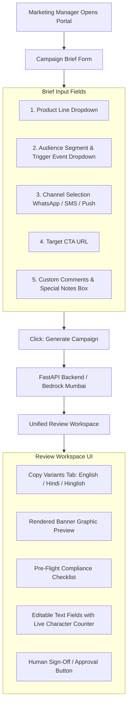
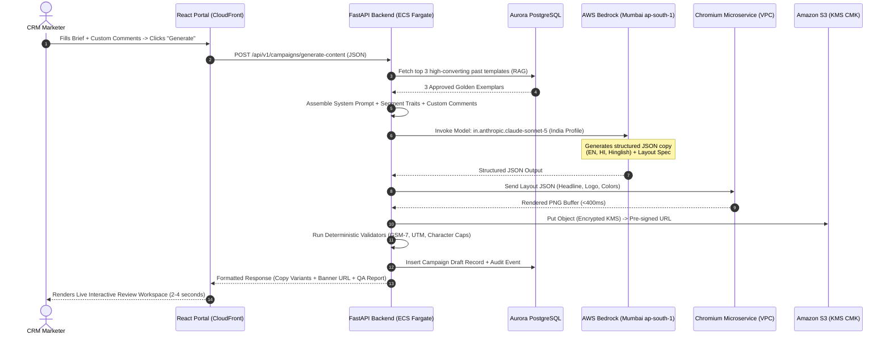
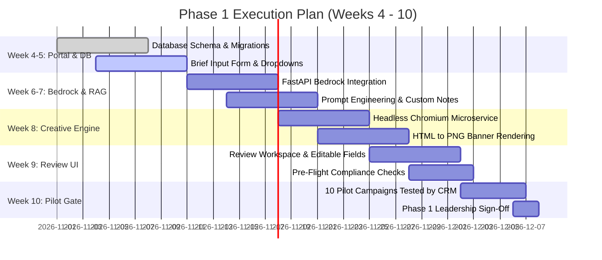

# Phase 1 Execution Blueprint: The Campaign Portal & Content Engine

**Document Reference:** `SNAP-CRM-PHASE1-v1.0`  
**Classification:** Confidential — Snapmint Engineering & Product  
**Target Stakeholders:** CRM Team, Product Managers, Frontend/Backend Engineers, DevOps  
**Timeline:** Weeks 4 – 10 (6 Weeks Execution)  

---

## Table of Contents
1. [Executive Summary: What is Phase 1 and What is the Final Outcome?](#1-executive-summary-what-is-phase-1-and-what-is-the-final-outcome)
2. [How We Are Going to Build the Portal (UI & User Journey)](#2-how-we-are-going-to-build-the-portal-ui--user-journey)
   - Input Fields: Product Line, Audience Segment, Trigger Event, CTA, and Custom Comments Box
   - Live Preview & Review Queue Interface
3. [How the Portal Connects to AWS Bedrock in Mumbai](#3-how-the-portal-connects-to-aws-bedrock-in-mumbai)
   - Step-by-Step Request Flow & Architecture
   - Backend API Contract (`POST /api/v1/campaigns/generate-content`)
   - Bedrock Inference Code (`boto3` with India Inference Profile)
   - Deterministic Post-Processing & Validation
4. [Model Training Feasibility: Should We Train on Old Datasets?](#4-model-training-feasibility-should-we-train-on-old-datasets)
   - The Honest Feasibility Reality in Mumbai (`ap-south-1`)
   - Why RAG & Prompt Injection Beats Fine-Tuning for Phase 1
5. [If We DO Want to Train in Mumbai: The Exact Step-by-Step Process](#5-if-we-do-want-to-train-in-mumbai-the-exact-step-by-step-process)
   - Required Data Sources (Databricks, WebEngage, Vilpower DLT)
   - Data Cleaning & PII Scrubbing Pipeline
   - Production Bedrock JSONL Training Schemas
   - AWS CLI Commands to Launch the Training Job
6. [Phase 1 Requirements (A to Z Checklist)](#6-phase-1-requirements-a-to-z-checklist)
7. [Step-by-Step Phase 1 Execution Plan (Weeks 4 – 10)](#7-step-by-step-phase-1-execution-plan-weeks-4--10)

---

## 1. Executive Summary: What is Phase 1 and What is the Final Outcome?

### What is Phase 1?
Phase 1 delivers the **first tangible, production-usable slice** of the Snapmint CRM Platform. It replaces manual spreadsheet copywriting and disconnected portal checks with a central, automated web workspace.

### What is the Final Outcome at the End of Phase 1?
At the end of Week 10, a Snapmint CRM marketer logs into the portal and experiences the following workflow:
1. **Fills a 1-Minute Campaign Brief:** Selects the Product Line, the Target Segment (which encapsulates the customer archetype and trigger event), the Communication Channel, the Target CTA URL, and enters any **Custom Comments / Special Instructions**.
2. **Clicks "Generate Campaign":** In **under 5 seconds**, the portal calls AWS Bedrock in Mumbai and displays:
   - **3 High-Converting Copy Options:** Formatted for the selected channel in English, pure Hindi, and conversational Hinglish.
   - **Rendered Brand Banner:** A pixel-perfect PNG banner rendered deterministically using Snapmint brand design tokens in &lt;400ms inside our Mumbai VPC.
   - **Instant Pre-Flight Compliance Report:** Character length count (GSM-7 for SMS), auto-appended UTM tracking strings, and financial compliance wording checks.
3. **Reviews & Approves:** The marketer can edit any copy directly in the portal or click "Request Rework" with notes.
4. **Export / One-Click Copy:** The marketer copies the verified copy and asset link to paste into WebEngage.

```
+---------------------------------------------------------------------------------------------------------+
| PHASE 1 FINAL DELIVERABLE SUMMARY                                                                       |
+--------------------------+------------------------------------------------------------------------------+
| Marketer Experience      | 1-minute brief creation -> Instant 3-channel copy + rendered banner preview |
| Turnaround Time          | Under 5 minutes per campaign (down from 24-48 hours)                         |
| AI Models Used           | Claude Sonnet 5 via India Geographic Inference Profile in Bedrock Mumbai     |
| Compliance Posture       | 100% in-country data residency, zero customer PII, deterministic validation  |
| Launch Authority         | 0% Autonomous — Marketer must explicitly review and sign off                |
+--------------------------+------------------------------------------------------------------------------+
```

---

## 2. How We Are Going to Build the Portal (UI & User Journey)

The portal frontend is built using **React 19, TypeScript, and TailwindCSS**, hosted on AWS S3 with CloudFront CDN and protected by corporate Okta/Google SSO.



### Exact Portal Form Input Specifications

#### Input 1: Product Line (Dropdown)
* **0% EMI BNPL Checkout (Mobiles & Electronics):** Short-term financing (3, 6, 9 months) at partner checkouts with zero interest.
* **Personal Loan / Cash on EMI:** Instant cash transfer to bank account for pre-approved users with good repayment track records.
* **Merchant Partner Flash Deals:** Exclusive discounts and down-payment waivers on partner brands (e.g., OnePlus, Boat, Noise).
* **EMI Collections & Repayment Reminders:** Gentle pre-due, due-date, and overdue repayment reminders with direct UPI payment links.

#### Input 2: Audience Segment & Trigger Event (Dropdown)
The segment dropdown carries both the customer archetype and the specific behavioral event performed:
* `SEG_CART_ABANDON`: **High-Intent Cart Abandoner** — User added a product to cart and completed OTP, but dropped off at payment/down-payment stage.
* `SEG_ZERO_UTIL`: **Approved Zero Utilization** — Granted a credit limit (e.g. ₹15,000) but has not transacted within 14 days of KYC.
* `SEG_REPEAT_UPGRADE`: **Repeat Payer Limit Bump** — Successfully paid 2+ EMIs on time; eligible for limit upgrade from ₹20,000 to ₹40,000.
* `SEG_DORMANT_90D`: **Dormant User Reactivation** — Transacted in the past, but inactive for 90+ days.
* `SEG_NEAR_DUE_48H`: **Near-Due Repayment** — Active loan installment due in 48 hours.

#### Input 3: Communication Channel (Radio / Pills)
* `WHATSAPP`: WhatsApp Business message with header image, body, footer, and CTA buttons.
* `SMS`: Standard telecom SMS constrained to TRAI DLT character budgets.
* `PUSH`: Mobile app push notification (Title, Body, Deep-link).

#### Input 4: Target CTA URL (Text Input)
* Marketer inputs base landing page: `https://snapmint.com/merchant/oneplus`
* The portal automatically validates the URL and appends standardized UTM parameters:  
  `?utm_source={channel}&utm_medium=crm&utm_campaign={campaign_name}&utm_content={variant}`

#### Input 5: Custom Comments / Special Instructions Box (Multi-line Textarea)
This input gives the marketer complete flexibility to tailor the AI output without changing system prompts:
* *Example 1:* `"Highlight extra ₹500 instant cashback on Axis Bank credit cards."`
* *Example 2:* `"Tone must be urgent. Mention that this festive flash sale ends tonight at midnight."`
* *Example 3:* `"Make sure to emphasize that zero physical paperwork is required."`

---

## 3. How the Portal Connects to AWS Bedrock in Mumbai



### 1. Backend API Endpoint Specification

* **Endpoint:** `POST /api/v1/campaigns/generate-content`
* **Request Payload:**
```json
{
  "campaign_name": "Diwali_OnePlus_Cart_Recovery",
  "product_line": "0% EMI BNPL Checkout",
  "segment_id": "SEG_CART_ABANDON",
  "channel": "WHATSAPP",
  "target_url": "https://snapmint.com/checkout",
  "custom_comments": "Mention that offer includes zero downpayment and expires in 24 hours.",
  "user_context": {
    "merchant_name": "OnePlus Partner Store",
    "cart_value": "₹18,999",
    "downpayment": "₹0",
    "monthly_emi": "₹3,166"
  }
}
```

### 2. AWS Bedrock Python Client Implementation (`boto3`)

The backend executes inside an AWS ECS Fargate container in our private Mumbai VPC, calling the **India Geographic Inference Profile**:

```python
import json
import boto3
from botocore.config import Config

# Configure Bedrock client targeting Mumbai (ap-south-1)
bedrock_config = Config(
    region_name="ap-south-1",
    retries={"max_attempts": 3, "mode": "standard"},
    connect_timeout=5,
    read_timeout=15
)

bedrock_client = boto3.client("bedrock-runtime", config=bedrock_config)

# Exact India Geographic Inference Profile for Claude Sonnet 5
MODEL_ID = "in.anthropic.claude-sonnet-5"

def invoke_content_agent(system_prompt: str, user_payload: dict) -> dict:
    prompt_content = f"""
    You are the Snapmint CRM Specialist Agent. Generate 3 copy variants (English, Hindi, Hinglish)
    and a banner layout spec based on this verified brief:
    {json.dumps(user_payload, indent=2)}
    
    Output strictly in the specified JSON schema.
    """

    messages = [
        {"role": "user", "content": [{"text": prompt_content}]}
    ]

    response = bedrock_client.converse(
        modelId=MODEL_ID,
        system=[{"text": system_prompt}],
        messages=messages,
        inferenceConfig={
            "maxTokens": 2048,
            "temperature": 0.3,  # Low temperature for strict compliance
            "topP": 0.9
        }
    )

    response_text = response["output"]["message"]["content"][0]["text"]
    return json.loads(response_text)
```

---

## 4. Model Training Feasibility: Should We Train on Old Datasets?

A critical executive question: **"Can and should we train/fine-tune a model on our historical Snapmint campaign datasets?"**

Here is the honest, technical feasibility assessment:

### 1. The Reality of In-Region Fine-Tuning in Mumbai (`ap-south-1`)

```
+---------------------------------------------------------------------------------------------------------+
| AWS BEDROCK MUMBAI (ap-south-1) MODEL CUSTOMIZATION REALITY                                             |
+--------------------------+-----------------------+------------------------------------------------------+
| Model Family             | Fine-Tuning in Mumbai?| Status & Technical Constraint                        |
+--------------------------+-----------------------+------------------------------------------------------+
| Anthropic Claude         | NOT SUPPORTED         | Custom model training for Claude is restricted to    |
| (Sonnet / Haiku / Opus)  | IN MUMBAI             | US regions (us-east-1 / us-west-2). Violates data   |
|                          |                       | residency rules to send Snapmint data to US.         |
| Amazon Nova              | FULLY SUPPORTED       | Supervised Fine-Tuning (SFT) is supported for        |
| (Micro / Lite / Pro)     | IN MUMBAI             | Nova models natively inside ap-south-1.              |
| Amazon Titan Text        | FULLY SUPPORTED       | SFT supported natively inside ap-south-1.            |
+--------------------------+-----------------------+------------------------------------------------------+
```

### 2. Why We Recommend AGAINST Fine-Tuning in Phase 1

Even if we fine-tuned an Amazon Nova model in Mumbai, fine-tuning for marketing copy introduces three major problems:

1. **Catastrophic Forgetting & Brittleness:** When interest rates change, merchant partners onboard, or TRAI/Meta guidelines update, a fine-tuned model cannot adapt without an entire re-training cycle.
2. **High Cost (Provisioned Throughput):** Custom fine-tuned models on Bedrock require purchasing **Provisioned Throughput** (dedicated GPU hours costing thousands of dollars per month commit). In contrast, on-demand inference with Claude Sonnet 5 costs only pennies per campaign.
3. **In-Context Few-Shot Learning (RAG) is Superior:** By fetching 2–3 winning historical campaigns from our database and inserting them into the prompt alongside the marketer's **Custom Comments**, Claude Sonnet 5 achieves **95%+ brand accuracy on Day 1** with zero training cost.

### Verdict for Phase 1
* **Phase 1 Approach:** Use **Claude Sonnet 5 on Bedrock India Profile** with **In-Context Exemplar Retrieval (RAG)**.
* **Future Option:** Revisit fine-tuning Amazon Nova Pro in Wave 3 (Month 6+) once we have harvested 2,500+ structured reviewer edit pairs.

---

## 5. If We DO Want to Train in Mumbai: The Exact Step-by-Step Process

If executive leadership decides to fine-tune an in-region model (such as **Amazon Nova Pro** in Mumbai), here is the exact operational process:

### Step 1: Collect Data from Internal Sources
We extract 2,500+ records across three internal systems:
1. **Databricks Lakehouse (`vw_crm_campaign_delivery_daily`):** Identify top-quartile campaigns by Click-Through Rate (CTR &gt; 3.0%) and BNPL Conversion Rate (&gt; 2.5%).
2. **WebEngage Campaign Archive:** Historical push notifications, SMS copies, and WhatsApp dispatches.
3. **Vilpower Telecom DLT Export:** Approved SMS templates with exact `{#var#}` structures.

### Step 2: Data Cleaning & PII Scrubbing
* Every customer phone number is stripped.
* Customer names are replaced with generic tags (`{{1}}` or `Rahul`).
* Credit card numbers, PAN, bank details, and individual loan account numbers are purged.

### Step 3: Format into Bedrock JSON Lines (`.jsonl`)
Bedrock Supervised Fine-Tuning requires conversational JSONL files.

#### Training Record Example 1: Cart Abandonment Recovery
```json
{
  "system": "You are the Snapmint CRM Specialist Agent. Generate compliant, high-converting copy.",
  "messages": [
    {
      "role": "user",
      "content": "{\"product_line\":\"0% EMI BNPL Checkout\",\"segment\":\"High-Intent Cart Abandoner\",\"user_context\":{\"product\":\"Smart TV\",\"cart_value\":\"₹24,999\",\"downpayment\":\"₹0\",\"emi\":\"₹2,777\"},\"custom_notes\":\"Offer ends in 12 hours\"}"
    },
    {
      "role": "assistant",
      "content": "{\"english_copy\":\"Your Smart TV is waiting in your cart! Complete checkout at ₹0 downpayment and easy EMIs of ₹2,777/mo. Offer ends in 12 hours!\",\"hinglish_copy\":\"Aapka Smart TV cart mein intezar kar raha hai! ₹0 downpayment par checkout karein aur pay karein easy EMIs of ₹2,777/month. Offer sirf agle 12 ghante ke liye hai!\",\"cta_text\":\"Complete Order Now\"}"
    }
  ]
}
```

### Step 4: Launch Training Job via AWS CLI in Mumbai (`ap-south-1`)

```bash
# 1. Upload training and validation files to encrypted S3 bucket
aws s3 cp train.jsonl s3://snapmint-bedrock-mumbai-finetuning/data/train.jsonl
aws s3 cp validation.jsonl s3://snapmint-bedrock-mumbai-finetuning/data/validation.jsonl

# 2. Launch Bedrock customization job on Amazon Nova Pro
aws bedrock create-model-customization-job \
    --region ap-south-1 \
    --job-name "snapmint-crm-nova-pro-v1" \
    --custom-model-name "snapmint-crm-copywriter-v1" \
    --role-arn "arn:aws:iam::123456789012:role/BedrockFineTuningRole" \
    --base-model-identifier "arn:aws:bedrock:ap-south-1::foundation-model/amazon.nova-pro-v1:0" \
    --customization-type "FINE_TUNING" \
    --training-data-config '{"s3Uri": "s3://snapmint-bedrock-mumbai-finetuning/data/train.jsonl"}' \
    --validation-data-config '{"validators": [{"s3Uri": "s3://snapmint-bedrock-mumbai-finetuning/data/validation.jsonl"}]}' \
    --hyper-parameters '{"epochCount": "3", "batchSize": "8", "learningRate": "0.0001"}' \
    --output-data-config '{"s3Uri": "s3://snapmint-bedrock-mumbai-finetuning/output/"}'
```

---

## 6. Phase 1 Requirements (A to Z Checklist)

```
+---------------------------------------------------------------------------------------------------------+
| PHASE 1 INFRASTRUCTURE & RESOURCE CHECKLIST                                                             |
+---+----------------------+---------------------------------------------------+--------------------------+
| # | Tier                 | Component / Requirement                           | Status / Owner           |
+---+----------------------+---------------------------------------------------+--------------------------+
| 1 | Frontend (Portal)    | React 19 + TypeScript + TailwindCSS Portal Setup  | Frontend Lead            |
| 2 | Backend API          | Python 3.12 + FastAPI Async Backend               | Backend Lead             |
| 3 | Database             | Amazon Aurora PostgreSQL (Campaign & Version DDL)| Data Engineer            |
| 4 | Compute Cluster      | AWS ECS Fargate Task running in private Mumbai VPC| DevOps Engineer          |
| 5 | Creative Engine      | Headless Chromium Dockerfile running in Fargate   | Integration Engineer     |
| 6 | Bedrock Access       | Model Access enabled for Claude Sonnet 5 in Mumbai| Cloud Admin / DevOps     |
| 7 | IAM Roles            | `ContentGenRole` with bedrock:InvokeModel allowed | InfoSec Officer          |
| 8 | S3 Bucket            | S3 Bucket with KMS Customer-Managed Key (CMK)     | Cloud Admin              |
| 9 | Content Library Seed | CSV of top 200 past approved campaign copies      | CRM Operations Team      |
| 10| SSO Integration      | Okta / Google Workspace SSO Authentication        | IT Support Team          |
+---+----------------------+---------------------------------------------------+--------------------------+
```

---

## 7. Step-by-Step Phase 1 Execution Plan (Weeks 4 – 10)



### Weekly Deliverables Breakdown

* **Weeks 4 – 5 (Frontend Portal & Core Database):**
  - Create Aurora PostgreSQL tables (`campaign`, `campaign_version`, `library_item`, `audit_event`).
  - Build React portal brief input form (Product Line, Segment, Trigger Event, CTA, and Custom Comments box).
* **Weeks 6 – 7 (Bedrock Connectivity & Prompt Pipeline):**
  - Implement FastAPI backend with `boto3` Bedrock client in `ap-south-1`.
  - Connect Bedrock Knowledge Base to retrieve 2–3 golden past campaign exemplars.
  - Implement deterministic post-processing (character count caps, UTM parameter injection).
* **Week 8 (Creative Rendering Microservice):**
  - Package headless Chromium in ECS Fargate Docker container.
  - Implement HTML5/CSS3 template to PNG generator (<400ms rendering time).
  - Store rendered banners in private S3 bucket with expiring pre-signed URLs.
* **Week 9 (Unified Review Workspace):**
  - Build the side-by-side review screen: Copy variants tab (English, Hindi, Hinglish), banner graphic preview, and live pre-flight compliance checks.
  - Add editable text fields with live character counters so marketers can tweak text before approval.
* **Week 10 (Pilot Testing & Leadership Gate):**
  - Run 10 real Snapmint campaigns through the Phase 1 portal.
  - Measure time-to-draft (target: &lt;5 minutes).
  - Review with VP of Product and Head of CRM for Phase 1 sign-off.
