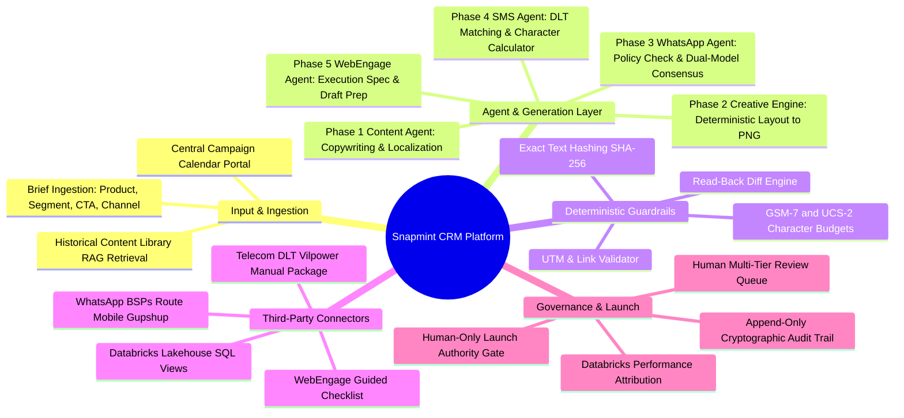
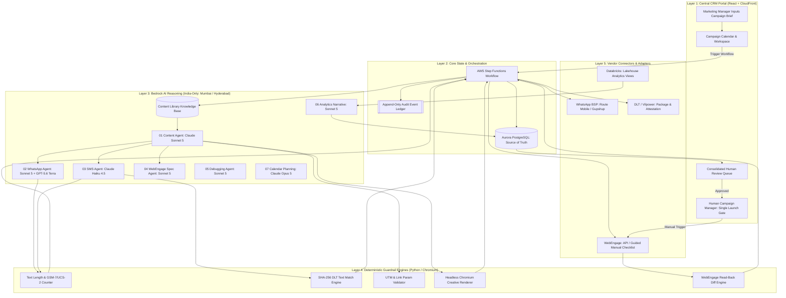
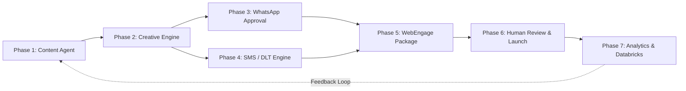
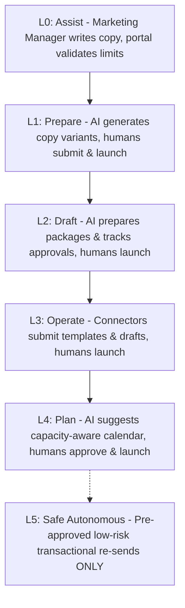

# Executive Management Brief & Feasibility Assessment
## Snapmint AI-Powered CRM Campaign Execution Platform

**Document Version:** 1.0.0  
**Date:** October 2026  
**Target Audience:** Founder, CEO, VP of Product, Head of CRM & Retention, VP of Engineering, Head of Information Security & Compliance  
**Author:** Senior Solutions Architecture & Technical Writing Group  

---

## Executive Summary: The 60-Second Overview

Snapmint's CRM and Retention team currently manages hundreds of monthly communications across WhatsApp, SMS, Push, and Email to drive repeat Buy Now, Pay Later (BNPL) purchases, EMI repayments, and merchant partner discoveries. Today, campaign preparation is fragmented across at least four disconnected portals: internal admin panels, telecom DLT portals (e.g., Vilpower), WhatsApp BSP dashboards (Route Mobile/Gupshup), and WebEngage. This fragmentation causes operational bottlenecks, slow turnaround times (often 24 to 48 hours per campaign), human copy-paste errors, and regulatory compliance risks under TRAI and Meta guidelines.

This initiative establishes **ONE Central CRM Campaign Calendar Portal**. A marketing manager inputs a campaign brief (product line, business objective, target segment, channel, CTA, landing page, and target time). The platform then orchestrates seven specialized AI agents and deterministic engines to automatically:
1. Generate high-converting, brand-compliant copy variants in English, Hindi, and Hinglish.
2. Render pixel-perfect visual creatives using deterministic brand design tokens and a headless browser engine.
3. Classify, validate, submit, and track WhatsApp message templates under strict Meta utility/marketing guidelines.
4. Verify SMS text against registered TRAI Distributed Ledger Technology (DLT) templates using cryptographic hashing and precise GSM-7/UCS-2 character limits.
5. Generate a verified WebEngage campaign execution package with deterministic read-back diff validation.
6. Provide a consolidated pre-flight QA report for human review.

**Crucial Governance Guarantee:** AI agents **never** possess campaign-launch authority. A human campaign manager must inspect the unified QA report and provide the final launch approval.

---

## 1. High-Level Concept Mindmap & Architecture

The following diagram illustrates how the platform flows from raw calendar input to channel dispatch, highlighting the boundary between AI reasoning, deterministic code, and human governance.

### System Concept Architecture Diagram

---

## 2. Hard Governance Rules (Non-Negotiable)

To protect Snapmint against regulatory fines, account bans, financial leakage, and privacy breaches, the following eight hard rules are embedded across every architecture layer:

1. **Four Separate Permissions (No Autonomous Launch):** AI agents never receive campaign-launch authority. The platform enforces four distinct permission tiers:
   - `generate_content` (AI generation of text and layout specs)
   - `submit_template` (External submission of WhatsApp/DLT templates)
   - `create_update_draft` (Creating or updating drafts on WebEngage)
   - `launch_campaign` (**Strictly reserved for authorized human campaign managers**)
2. **Authoritative WhatsApp Classification (No Utility Disguise):** Promotional or marketing copy must never be disguised as a "Utility" template to save message costs. Meta and BSP classification algorithms are authoritative. Violations incur severe quality rating drops and risk WhatsApp Business Account (WABA) suspension.
3. **No Automated Bypass of Telecom Auth (DLT):** The platform will never attempt to automate, bypass, or script past CAPTCHA, SMS OTPs, or mandatory human regulatory attestations on telecom DLT portals (Vilpower/Jio/Airtel).
4. **Honest Vendor Integration Boundaries:** If a vendor API cannot programmatically create a campaign draft (e.g., WebEngage public API limitations), the platform generates a production-ready **Execution Specification Package** with a clearly marked **MANUAL** step in the UI. Systems must never simulate or pretend an external action occurred.
5. **Idempotency & "Needs Verification" State:** Blind retries on external mutation calls are strictly forbidden. Every external mutation carries an idempotency token: `Hash(campaign_id + version + operation_type)`. If an external call times out or returns an ambiguous network error, the campaign is locked into a **"Needs Verification"** state until reconciled.
6. **Deterministic Code vs. AI Separation:**
   - **Deterministic Code Validates:** Character limits, GSM-7/UCS-2 encoding, UTM parameters, destination URLs, variable syntax, exact text hash matching, and read-back diffs.
   - **Deterministic SQL Generates Metrics:** All conversion, GMV, and delivery numbers are derived directly from Databricks Lakehouse SQL views. Large Language Models are strictly prohibited from calculating mathematical figures.
   - **AI Specializes In:** Copywriting, contextual adaptation, brief translation, error explanation, and schedule optimization.
7. **Zero Customer PII in Model Prompts:** Agents receive brief metadata, product parameters, brand guidelines, pre-approved templates, and aggregated demographic cohort statistics. Customer-level Personally Identifiable Information (Names, Phone Numbers, PAN, Bank Details, Credit Limits) is **strictly forbidden** from entering model prompts.
8. **The Portal/Database is the Source of Truth:** The internal Aurora PostgreSQL database is the authoritative system of record. Every agent run, human review, external vendor dispatch, and status transition is recorded in an immutable, append-only audit trail.

---

## 3. Comprehensive AWS Bedrock Mumbai Feasibility Assessment

A central executive question is whether this entire platform can be deployed and operated within **AWS Bedrock in the Mumbai Region (`ap-south-1`)** while satisfying Indian regulatory requirements (RBI Digital Lending Guidelines, Digital Personal Data Protection Act 2023).

### Detailed Technical Feasibility Matrix (As of October 2026)

| Architectural Component | Target Capability | Bedrock Mumbai (`ap-south-1`) Feasibility | Technical Finding & Implementation Strategy |
|---|---|:---:|---|
| **Primary Reasoning & Copywriting** | Claude Sonnet 5 / GPT-5.6 Terra | **HIGH (India Cross-Region)** | Available via **India Geographic Inference Profiles** (`in.anthropic.claude-sonnet-5`, `in.openai.gpt-5.6-terra`). Dynamically balances compute between Mumbai (`ap-south-1`) and Hyderabad (`ap-south-2`). Data remains strictly inside Indian borders. Zero Data Retention (ZDR) enforced. |
| **Routine Classification & SMS Prep** | Claude Haiku 4.5 / Nova Pro | **HIGH (India Cross-Region)** | Claude Haiku 4.5 is available under the India-only profile (`in.anthropic.claude-haiku-4-5`). Highly cost-effective for high-volume tasks like GSM-7 variable verification and triage. `VERIFY:` Nova Pro in-region profile status. |
| **Complex Calendar Planning** | Claude Opus 5 | **HIGH (India Cross-Region)** | Claude Opus 5 is available under the India-only inference profile (`in.anthropic.claude-opus-5`) for advanced multi-variable operations research and scheduling. |
| **Knowledge Base & Retrieval (RAG)** | Bedrock Knowledge Bases + Embeddings | **HIGH (In-Region Mumbai)** | Amazon Titan Text Embeddings V2 and Bedrock Knowledge Bases run natively in `ap-south-1`. Vector storage evaluated between OpenSearch Serverless (Mumbai) and PostgreSQL `pgvector` on Aurora. Cohere Multilingual v3 is available in Mumbai for Hindi/Hinglish semantic search. |
| **AI Guardrails & PII Redaction** | Bedrock Guardrails | **HIGH (In-Region Mumbai)** | Bedrock Guardrails are natively available in `ap-south-1`. Provides automated PII masking, toxic content filtering, and regulatory topic boundaries before prompts reach models. |
| **Visual Creative Generation (Image Models)** | Stable Diffusion 3.5 / Stable Image / Nova Canvas | **NOT FEASIBLE IN INDIA** | **Critical Finding:** There is **NO** production AI image generation model operating inside India AWS data centers. Stable Diffusion/Image models reside exclusively in US/EU regions (e.g., `us-west-2`), and Amazon Nova Canvas reached end-of-life on September 30, 2026. Calling US endpoints would violate data residency rules. |
| **Visual Creative Generation (Alternative)** | Deterministic Layout + Headless Chromium Renderer | **HIGH (100% In-Region Mumbai)** | **Architectural Solution:** The model outputs a structured JSON layout specification (copy, colors, badge text, partner logo IDs, product image keys). A deterministic microservice running headless Chromium inside our Mumbai VPC renders the HTML/CSS template to a high-resolution PNG in under 400ms. **Result:** 100% brand typography compliance, zero visual hallucination, and 100% data residency in Mumbai. |
| **Workflow Orchestration** | AWS Step Functions + SQS DLQ | **HIGH (Native `ap-south-1`)** | Native AWS managed services operating in Mumbai with VPC endpoints. Fully compliant with enterprise data protection standards. |
| **Database & Audit Trail** | Aurora PostgreSQL Multi-AZ + KMS | **HIGH (Native `ap-south-1`)** | Native encrypted storage in Mumbai. S3 bucket with KMS customer-managed keys (CMK) stores rendered assets with time-limited pre-signed URLs. |

### Regulatory & Data Sovereignty Finding
* **The "India-Only" Policy:** The AWS India Geographic Inference Profiles route dynamically between Mumbai (`ap-south-1`) and Hyderabad (`ap-south-2`). Because both data centers are physically located in the Republic of India, this satisfies RBI and DPDP localization mandates.
* `VERIFY:` Confirm with Snapmint InfoSec in Week 1 whether company policy permits "India-Only" (Mumbai + Hyderabad) or mandates "Mumbai-Only". If "Mumbai-Only" is strictly mandated, foundation model choices are restricted to direct regional endpoints, which may alter model availability.
* **Audit Trail:** AWS CloudTrail must be configured to log the resolved inference region for every Bedrock API call, proving to internal and external auditors that no inference exited Indian borders.

---

## 4. Phase-by-Phase Engine Breakdown

The platform is designed around seven modular phases, executing in a coordinated pipeline:

### Phase 1: Content & Copywriting Agent
* **Role:** Transforms brief attributes (e.g., "0% EMI on Electronics, Diwali Sale, Pre-approved Users") into tailored multi-channel copy variants.
* **Model:** Claude Sonnet 5 (`in.anthropic.claude-sonnet-5`).
* **Capabilities:** Generates copy across English, pure Hindi, and conversational Hinglish ("Abhi khareedo, baad mein pay karo"). Retrieves past high-converting examples from the Content Library via Bedrock Knowledge Base.
* **Deterministic Guardrails:** Hard validators enforce character caps per channel, ensure required UTM parameters are appended to destination URLs, and verify that financial terms (e.g., "0% Interest", "No Cost EMI") match approved compliance wording.

### Phase 2: Creative Rendering Engine (Deterministic Layout to PNG)
* **Role:** Generates production-ready banner graphics and WhatsApp header images without using non-compliant external generative image models.
* **Architecture:** 
  1. The Content Agent outputs a structured **Layout Specification JSON** defining template type, headline text, badge discount, primary CTA text, color palette, and asset keys for merchant partner logos.
  2. A lightweight Python service running headless Chromium in ECS Fargate (Mumbai VPC) injects these values into verified HTML5/CSS3 templates.
  3. Chromium renders the DOM to a PNG image at exact target resolutions (1080x1080 for Instagram/Push, 800x418 for WhatsApp headers).
  4. The image is uploaded to a private Amazon S3 bucket with KMS encryption, generating an expiring signed URL.
  5. A secondary multimodal check (Claude Sonnet 5 Vision) performs automated visual QA to ensure no text overlaps, logo clipping, or contrast defects exist.

### Phase 3: WhatsApp Template Approval Agent (Utility vs. Marketing)
* **Role:** Formats message templates, determines the appropriate Meta category, enforces anti-disguise policies, submits templates via BSP APIs, and monitors approval webhooks.
* **The Challenge:** WhatsApp enforces strict pricing and policy differences between **Utility** (transactional/account alerts, cheaper) and **Marketing** (promotions, offers, higher cost). Submitting promotional text under Utility causes immediate rejection by Meta or account quality penalties.
* **Dual-Model Consensus Architecture:**
  1. **Primary Model (Claude Sonnet 5)** classifies the template and provides a policy rationale.
  2. **Secondary Arbiter (OpenAI GPT-5.6 Terra)** independently evaluates the classification.
  3. If both models agree that a template is strictly Utility (e.g., an exact repayment reminder with dynamic loan ID variables), it proceeds.
  4. If either model flags promotional intent, or if they disagree, the platform **automatically locks the category to Marketing** or escalates to a human CRM manager.
* **Submission Engine:** Formats the payload for the active BSP (Route Mobile, Gupshup, or Infobip) and polls/receives webhook callbacks for status updates (`APPROVED`, `REJECTED`, `FLAGGED`).

### Phase 4: SMS & DLT Compliance Agent (TRAI Mandates)
* **Role:** Ensures 100% compliance with Telecom Regulatory Authority of India (TRAI) Distributed Ledger Technology (DLT) regulations.
* **Regulatory Context:** Downstream Indian telecom operators drop any SMS whose text does not match an approved DLT Content Template ID registered under Snapmint’s Principal Entity ID (PE ID) and 6-character Sender Header ID (e.g., `SNPMNT`).
* **Matching Engine:**
  1. Computes the normalized SHA-256 hash of the generated SMS copy.
  2. Matches text against Snapmint’s local database of pre-registered DLT templates.
  3. Identifies dynamic variables (`{#var#}`) and validates that inserted variable values do not alter static text.
  4. Runs a deterministic character calculator: computes whether the message fits into standard **GSM-7** (160 characters/credit) or requires **UCS-2** (70 characters/credit for Hindi/Devanagari/emojis), calculating the exact credit cost.
* **Manual Packaging Flow:** If no existing DLT template matches, the agent prepares a complete **DLT Registration Package** (Category, Header ID, Template Name, Text with Variable Placeholders). The CRM operator copies this package to register it on Vilpower/Jio DLT. The platform **never** attempts to automate CAPTCHA or OTP solving.

### Phase 5: WebEngage Draft Execution Package & Read-Back Verification
* **Role:** Prepares the complete omnichannel campaign package for WebEngage, orchestrating targeting parameters, channel payloads, and timing.
* **The Integration Reality:** WebEngage’s public REST API provides endpoints for tracking user events and triggering already-running transactional campaigns, but **does not provide official public REST endpoints to create fresh campaign drafts from scratch**.
* **The Implementation Strategy (Decision Tree):**
  - **Primary Approach (Guided Execution Package):** The agent generates a validated JSON/Visual Execution Specification. The CRM portal displays a guided, split-screen checklist where the operator copies verified fields (or uses a dedicated companion tool) into the WebEngage dashboard.
  - **Spike Protocol (Weeks 1-4):** During Phase 0, engineering will test private/enterprise endpoints and MCP server connectors. If an API draft creation method is confirmed, it will be enabled under strict sandbox conditions.
* **Deterministic Read-Back Verification:** Once a draft exists on WebEngage, the platform reads back the draft configuration via API/read-token and performs an automated SHA-256 text diff against the internal database. If a single character, UTM tag, or variable differs, the campaign is flagged **"Draft Mismatch"** and blocked from launching.

### Phase 6: Analytics & Databricks Lakehouse Feedback Loop
* **Role:** Ingests campaign delivery and business outcome metrics to close the learning loop.
* **The Golden Rule:** All conversion rates, delivery statistics, click-through rates (CTR), BNPL loan originations, and 30-day EMI default metrics come **strictly from verified Databricks SQL queries**. AI models never calculate or extrapolate numbers.
* **The Feedback Loop:** The Analytics Agent reviews SQL metrics against historical benchmarks and writes qualitative performance summaries. Campaigns with superior performance (top 10% conversion) are automatically tagged and ingested into the Content Library knowledge base, ensuring future agent generations learn from winning patterns.

### Phase 7: Calendar Planning & Capacity Optimization Agent
* **Role:** Recommends weekly and monthly campaign schedules to maximize GMV while preventing customer fatigue.
* **Model:** Claude Opus 5 (`in.anthropic.claude-opus-5`) combined with a deterministic constraint solver.
* **Constraints Managed:** Customer frequency caps (e.g., maximum 2 promotional WhatsApps per customer per week), channel budget allocations, merchant promotional deadlines, and historical day-of-week engagement curves.

---

## 5. Automated vs. Manual Boundary Matrix

To guarantee compliance and eliminate operational ambiguity, the boundary between automated tasks and mandatory human actions is clearly defined:

| Workflow Stage | Automated (AI Model & Deterministic Code) | Strictly Manual (Human Responsibility) |
|---|---|---|
| **Brief & Planning** | • Pulls historical benchmarks from Content Library • Suggests optimal send-time and channel mix • Flags audience saturation conflicts | • Inputs initial business targets and merchant budget • Selects target segment and final send-time • Approves monthly campaign calendar |
| **Copy & Creative** | • Generates multi-language copy variants (EN/HI/Hinglish) • Enforces character limits, UTM tags, compliance terms • Renders brand-aligned PNG creatives via headless Chromium • Automated visual QA check via Claude Vision | • Selects preferred copy variant from generated options • Approves final visual banner design • Adds custom business nuances where needed |
| **WhatsApp Compliance** | • Dual-model policy classification (Utility vs. Marketing) • Rejection risk scoring based on Meta guidelines • Submits approved templates to BSP API (Route/Gupshup) • Webhook monitoring for approval status | • Resolves classification disagreements between models • Manages business profile settings on Meta Business Manager • Signs off on any message categorized as Utility |
| **SMS / DLT Compliance** | • Computes SHA-256 hash of SMS copy • Matches text against pre-approved DLT template database • Calculates GSM-7 vs. UCS-2 character and credit budgets • Prepares DLT registration package if unmatched | • Logs into telecom DLT portal (Vilpower/Jio) with 2FA/OTP • Solves CAPTCHA and completes legal entity attestations • Submits new templates for telco verification |
| **WebEngage Drafting** | • Formats complete campaign execution specification • Injects verified copy, creative URLs, and UTM strings • Reads back WebEngage draft configuration • Executes automated text diff and mismatch detection | • Manages WebEngage audience segment definitions • Creates campaign draft if API draft creation is unavailable • Validates test sends on personal mobile devices |
| **Campaign Launch** | • **STRICTLY PROHIBITED (Zero launch authority)** • Verifies all pre-flight check gates pass • Locks campaign state to "Ready to Launch" | • **Exclusive Authority: Final Human Reviewer** • Performs pre-launch visual inspection • Clicks final "Launch / Schedule Campaign" button |
| **Post-Launch & Learning**| • Databricks SQL queries compute delivery, clicks, and GMV • Analytics Agent drafts executive performance summary • Auto-tags high-performing copy into Content Library | • Reviews weekly performance summaries • Approves content items for long-term library retention • Investigates conversion anomalies or drop-offs |

---

## 6. Strategic Architectural Recommendations

Based on our architectural assessment, we recommend five key enhancements over the baseline workflow to eliminate vendor risk, reduce operational friction, and guarantee data compliance:

### 1. Adopt an "Execution Spec Package First" Architecture for WebEngage
* **Context:** Public documentation confirms that WebEngage does not provide a public REST API endpoint to programmatically create fresh campaign drafts from scratch.
* **Our Recommendation:** Do not block Phase 1 delivery on WebEngage API access. Build the platform around an **Execution Specification Package** model from Day 1. The platform outputs a standardized, validated execution bundle (complete copy, asset links, audience criteria, UTM tags, and schedule) displayed in a clean side-by-side portal view. The operator completes the draft setup with one-click copy actions. In parallel, run integration spikes (Weeks 1-4) to test enterprise private APIs or dedicated browser automation. This ensures Wave 1 goes live on schedule regardless of vendor API status.

### 2. Enforce Dual-Model Consensus for WhatsApp Utility Classification
* **Context:** Misclassifying a promotional message as a Utility template saves message delivery costs in the short term but incurs severe penalties from Meta, including automatic re-categorization, back-billing at higher rates, quality score demotion, and potential WABA suspension.
* **Our Recommendation:** Implement a strict two-model consensus protocol. Claude Sonnet 5 acts as the primary classifier, and OpenAI GPT-5.6 Terra acts as the independent policy auditor. If both models agree with >95% confidence that the message is strictly transactional (e.g., payment confirmation or loan schedule), it is marked as Utility. If either model detects promotional language, the category is hard-locked to Marketing. If the models disagree, it is escalated to a human CRM manager.

### 3. Deploy a Cryptographic SHA-256 DLT Hash Ledger for SMS
* **Context:** Telecom DLT gateways reject SMS dispatches if the delivered text differs from the approved template by even a single trailing whitespace, punctuation mark, or unapproved variable format.
* **Our Recommendation:** Do not rely on LLMs to verify SMS matching. Implement a deterministic cryptographic hashing pipeline: normalize the copy (strip variable whitespace, convert to standard Unicode, replace variables with canonical placeholders `{#var#}`) and compute its SHA-256 hash. Compare this hash against our local Aurora PostgreSQL DLT template table. If the hash does not match an approved DLT Template ID, the message cannot proceed.

### 4. Utilize Deterministic Headless Chromium Rendering in Place of Generative Image AI
* **Context:** No production AI image generation models (Stable Diffusion, Nova Canvas) reside within AWS Indian data centers. Calling US-based image generation models introduces regulatory exposure under RBI/DPDP guidelines, exhibits high latency (5-15 seconds per image), and frequently produces hallucinated typography and improper brand alignments.
* **Our Recommendation:** Build a deterministic rendering microservice running headless Chromium inside our Mumbai ECS Fargate cluster. Foundation models generate structured layout JSON (text, colors, partner badges, product asset IDs). The rendering engine injects this into pre-approved, responsive HTML/CSS templates, generating high-resolution PNGs in under 400 milliseconds with 100% typographic accuracy and complete data residency.

### 5. Implement Step Functions Circuit Breakers & Dead-Letter Escalation
* **Context:** External marketing APIs (WhatsApp BSPs, SMS gateways, WebEngage) occasionally experience outages, throttling, or high network latency during peak Indian festive shopping events (e.g., Diwali, Republic Day sales).
* **Our Recommendation:** Structure all external API operations inside AWS Step Functions with exponential backoff and circuit breakers. If an external API call times out or returns an HTTP 5xx error, the workflow must **never** retry blindly. The task transitions the campaign record to a **"Needs Verification"** state, emits a notification to the SQS Dead Letter Queue, and alerts the engineering on-call engineer via Slack/PagerDuty.

---

## 7. Autonomy Ladder: Progression to Autonomous Operations

To build institutional trust and ensure safety, the platform implements a five-level autonomy framework:

* **L0: Assist (Day 1 Baseline):** Marketing managers manually draft briefs; deterministic engines validate character limits, UTM parameters, and DLT hash matches.
* **L1: Prepare (Wave 1 - Weeks 4-10):** Content Agent generates copy variants and creative specs; human reviews and manually copies assets to vendor tools.
* **L2: Draft (Wave 2 - Weeks 10-24):** WhatsApp Agent submits templates via BSP API; platform prepares WebEngage execution packages and verifies drafts via read-back diffs.
* **L3: Operate (Wave 3 - Weeks 20-34):** Automated template tracking, automated error diagnosis, and lakehouse performance feedback active across all channels.
* **L4: Plan (Wave 5 - Weeks 38-52):** Planning Agent proposes the weekly campaign calendar, balancing capacity, audience fatigue, and historical conversion curves.
* **L5: Optional Safe Autonomous (Future Policy Decision):** Automated execution restricted strictly to pre-approved, non-promotional, low-risk operational updates (e.g., standard billing date alerts). **This is a corporate policy decision, not an engineering milestone.** In initial releases, L5 is disabled across the codebase.

---

## 8. Delivery Roadmap: Waves 0 through 5 (12-Month Plan)

The project is structured into six delivery waves executed by a dedicated team of ~5 engineers:

| Wave | Timeline | Focus Area | Deliverables & Milestones | Gateway Criteria |
|---|---|---|---|---|
| **Wave 0** | Weeks 0-4 | Foundations & Technical Spikes | • Golden evaluation benchmark dataset (50-100 historical campaigns) • Bedrock Mumbai inference profile setup & CloudTrail audit • WebEngage, WhatsApp BSP, and DLT integration spikes • Initial Content Library seeding (top 200 past campaigns) | **Week 4 Gate:** Security approval of India inference profile; WebEngage spike findings signed off; Golden eval harness operational. |
| **Wave 1** | Weeks 4-10 | Thin-Slice Production Pilot | • Central Campaign Calendar Portal v1 (React + FastAPI) • Content & Copy Agent (Claude Sonnet 5 in Mumbai) • Headless Chromium creative rendering engine • WhatsApp packaging engine & WebEngage guided checklist • Unified human review queue | **Week 10 Gate:** Pilot live with 10 real Snapmint campaigns; 0% compliance violations; >=70% reviewer usability score. |
| **Wave 2** | Weeks 10-24 | Automated Connectors & Handoffs | • WhatsApp BSP connector (automated template submission & status tracking) • SMS / DLT exact hash matcher and character calculator • WebEngage draft sync with automated read-back diff verification • Idempotency and "Needs Verification" recovery workflows | **Week 24 Gate:** WhatsApp first-pass approval >=90%; WebEngage draft read-back mismatch rate <2%. |
| **Wave 3** | Weeks 20-34 | Channel Breadth & Resilience | • Full support for Hindi and Hinglish localized campaigns • Push notification and In-App message specs • Automated Debugging Agent for vendor API failures • Data quality and prompt regression monitors | **Week 34 Gate:** Multilingual campaigns successfully launched; automated triage resolves >=60% of common API errors. |
| **Wave 4** | Weeks 30-40 | Databricks Lakehouse Feedback | • Databricks SQL view integration for delivery, clicks, and BNPL originations • Analytics Agent producing WoW, MoM, and MTD performance narratives • Automated Content Library feedback loop (seeding winning copy) | **Week 40 Gate:** 100% of performance metrics verified against Databricks; automated library scoring active. |
| **Wave 5** | Weeks 38-52 | Calendar Planning & Optimization | • Calendar Planning Agent (Claude Opus 5 + constraint solver) • Audience fatigue tracking and channel frequency capping • Predicted-vs-actual campaign performance models | **Week 52 Gate:** System-generated calendar proposals adopted for >=50% of monthly campaigns; overall campaign preparation time reduced by 75%. |

---

## 9. Team Structure & Resource Requirements

To deliver this platform over the 12-month timeline, a dedicated cross-functional pod of approximately 5 full-time engineers (FTEs) is required:

* **1 Lead Solutions Architect / Tech Lead:** Overall system architecture, AWS infrastructure, security governance, and vendor technical alignment.
* **1 Senior Full-Stack Engineer (Frontend/Portal):** React + TypeScript portal development, calendar interface, campaign workspace, and review queue UI.
* **1 Senior Backend / Workflow Engineer:** Python (FastAPI) core services, PostgreSQL database schema, AWS Step Functions, SQS queues, and idempotency logic.
* **1 AI / Prompt & Evaluation Engineer:** Bedrock prompt engineering, Bedrock Knowledge Base setup, golden evaluation harness, model bake-off, and guardrail rules.
* **1 Integration & Data Engineer:** Third-party connectors (WhatsApp BSPs, WebEngage, DLT), Chromium rendering microservice, and Databricks SQL lakehouse pipelines.

---

## 10. Success Metrics & Return on Investment (ROI)

The platform’s business impact will be tracked across four core operational dimensions:

| Dimension | Baseline (Today) | Target (Wave 2) | Mature Target (Wave 5) |
|---|---|---|---|
| **Campaign Turnaround Time** | 24 - 48 hours per campaign | 4 - 6 hours per campaign | **< 45 minutes** (from brief to ready-to-launch) |
| **WhatsApp First-Pass Approval** | ~75% (frequent rejections) | >= 90% | **>= 98%** (zero utility disguise rejections) |
| **DLT & SMS Formatting Errors** | ~12% dispatch failure rate | < 1% | **0.0%** (cryptographic hash enforcement) |
| **WebEngage Draft Accuracy** | High manual copy-paste errors | < 2% read-back diffs | **100% verified read-back match** |
| **CRM Team Capacity** | ~40 campaigns / month / team | ~100 campaigns / month | **250+ campaigns / month** (same team size) |

---

## 11. Key Decisions Required in Week 1

To initiate Phase 0 without engineering delay, executive leadership and the security council must formally decide on the following five items:

1. **Inference Profile Data Residency Scope:** Formally approve the use of AWS Bedrock’s **India Geographic Inference Profile** (routing between Mumbai `ap-south-1` and Hyderabad `ap-south-2`), confirming that dynamic load distribution between these two Indian data centers complies with Snapmint's data sovereignty policies.
2. **Deterministic Creative Rendering vs. Cloud Image Models:** Formally approve the strategy to use deterministic HTML/CSS headless Chromium rendering inside our Mumbai VPC for creative asset generation, eliminating cross-border data transfer to US-based generative image models.
3. **WebEngage Execution Strategy:** Endorse the "Guided Execution Package" approach as the baseline delivery path for Wave 1, while engineering conducts the W1-W7 API/MCP spike during Weeks 1-4.
4. **WhatsApp Utility vs. Marketing Consensus Policy:** Approve the mandatory Dual-Model Consensus policy requiring unanimous agreement between two independent model families before any template can be submitted as Utility.
5. **Human-Only Launch Authority Mandate:** Reaffirm that no autonomous campaign launch authority will be granted to AI agents during Waves 0 through 5, and that the single launch gate remains exclusively with authorized human campaign managers.
